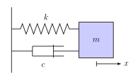



# Differential Equations {#sec-differential-equations}

::: {.callout-tip}

## Aims of the chapter

By the end of this chapter, you should be able to:

* Explain what an ordinary differential equation is and classify it.
* Solve simple first order differential equations.
* Analyse the behaviour of first order autonomous equations.
* Solve linear second order differential equations.

:::

Because of their fundamental importance and success in many scientific fields, differential equations have become a field within the mathematical sciences and are an integral part of training in mathematics. One fundamental question is whether a differential equation has solutions and, if so, whether the solution is unique. We will see some counterexamples showing that this is not always the case but have to delay deeper results on this questions because they require sophisticated analytical tools that we don't have to our disposition yet.

If one can show that there is a solution, a natural question is whether we can find an explicit formula for it. We will study some techniques that enable us to do so for some simple differential equations. However, in general, this is not the case, and for this reason computational methods have been developed that approximate the solution. We may occasionally make use of the computer but the in-depth study of such methods is left to future modules.

Even if we cannot find an explicit solution formula, we still may be able to make some qualitative predictions about the behaviour of the solution. For time dependent problems this comprises the long-term behaviour, for instance, whether the solution grows, or remains bounded, or oscillates, or converges to an equilibrium state. We will also look a bit into so-called stability properties, i.e., how this qualitative behaviour changes if data or parameters in the differential equation change. Such questions will also be picked up in follow-up modules.

## General concepts

General scalar differential equations can be written in the form

$$
\mathcal{F} \left( x,y(x),y'(x), y''(x), \dots, y^{(k-1)}, y^{(k)} \right) = 0
$$ {#eq-deq-general}

for some given function $\mathcal{F} : (\alpha, \beta) \times \mathbb{R}^{k+1} \to \mathbb{R}$ with an interval $(\alpha,\beta) \subset \mathbb{R}$. We here use the notation

$$
y^{(l)}(x) = \frac{d^l}{\mathrm{\mathrm{d}}x^l} y(x)
$$

for the $l$-th derivative of a function $y : (\alpha, \beta) \to \mathbb{R}$. In the general form (@eq-deq-general) we make the implicit assumption that the highest derivative $y^{(k)}$ occurs in the equation (otherwise we could consider a function $\mathcal{F}$ that does not depend on this argument). We will focus on equations where we can solve the equation for $y^{(k)}$ and write it in the form

$$
y^{(k)}(x) = \phi \left( x, y(x), \dots, y^{(k-1)}(x) \right)
$$ {#eq-deq-generalB}

for some function $\phi : (\alpha, \beta) \times \mathbb{R}^{k} \to \mathbb{R}$.

Our equation is expressed in terms of the *variables* $x$ and $y$. We distinguish:

- *Independent variables* can be varied independently of any other variables. In @eq-deq-gen-o1, $x$ is an independent variable.
- *Dependent variables* are unknown quantities that depend on independent variables. In @eq-deq-gen-o1, $y$ is a dependent variable, which depends on $x$.

The equation may also depend on parameters, which are constant quantities that are fixed for a given problem but can be varied between problems. For example, if we wrote an equation for a weight on a spring, the mass of the weight would be a parameter.

The variables are kind of placeholders and used to express the differential equation. We could have used other letters, for instance,
$$
z^{(k)}(\theta) = \phi \left( \theta, z(\theta), \dots, z^{(k-1)}(\theta) \right) \quad \text{and} \quad x^{(k)}(t) = \phi \left( t, x(t), \dots, x^{(k-1)}(t) \right)
$$

express the same differential equation @eq-deq-generalB. Note that $x$ stands for the dependent variable in the last reformulation. This concept of a variable is known from other areas such as the formulation of algorithms or integration: given an integrable function $g : (a,b) \to \mathbb{R}$, the expressions

$$
\int_a^b g(x) \mathrm{d}x, \quad \int_a^b g(y) \mathrm{d}y, \quad \int_a^b g(\theta) \mathrm{d}\theta
$$

all mean the same, $x$, $y$, or $\theta$ stand for a variable that has no effect on the integral.

In the literature, the variable $t$ is often stands for time and $x,y,z$ are spatial variables. Recall from @sec-introduction that we will sometimes use dots and dashes to denote derivatives.


::: {.callout-important}
::: {#def-deq-basics}
For a differential equation of the form @eq-deq-general we define:

1. The *order* of a differential equation is the order of its highest derivative.
2. The differential equation is *autonomous* if $\mathcal{F}$ does not depend on the independent variable, so $\mathcal{F} : \mathbb{R}^{k+1} \to \mathbb{R}$, and the differential equation reads

   $$
   \mathcal{F} \left( y(x),y'(x), \dots, y^{(k)} \right) = 0.
   $$

3. The differential equation is *homogeneous* if setting the dependent variable and all its derivatives to zero yields zero, i.e.
   $$ s(x) := \mathcal{F}(x, 0, 0, \dots, 0) = 0.$$

   Otherwise, the differential equation is *inhomogeneous*.

4. The differential equation is *linear* if $\mathcal{F}$ can be written in the form

   $$
   \mathcal{F} \left( x,y(x),y'(x), \dots, y^{(k)} \right) = s(x) + \sum_{i=0}^{k} a_i(x) y^{(i)}(x)
   $$ {#eq-deq-lin-gen}

   with some functions $s, a_i : (\alpha,\beta) \to \mathbb{R}$, $i=0, \dots, k$. Note that, when $s(x) \equiv 0$ the linear equation is homogeneous.


A couple of remarks on the above formal definitions:

- Note that the functions $s$ defined in the last two items coincide if $\mathcal{F}$ is linear (which also explains the same notation).

- If the differential equation is autonomous then $s$ cannot depend on the independent variable $x$ but can be a constant, so the equation still can be inhomogeneous.

- There are even more general differential equations, in particular for functions of several variables. For instance, the equation

  $$
  \frac{\partial^2}{\partial t^2} u(x,t) - \frac{\partial^2}{\partial x^2} u(x,t) = 0
  $$

  is a simple equation for the propagation of waves. Such equations that involve partial derivatives with respect to multiple (more than one) independent variable are called *partial differential equations (PDE)*. In this module, we focus on differential equations for functions of one independent variable only. These are called *ordinary differential equations (ODE)*, even though in this module we may sometimes refer to them simply as differential equations for simplicity.

:::
:::

Let us briefly classify some of the differential equations.

::: {#exm-classify-odes}

1. Consider the equation

   $$
   \dot{p}(t) = k p(t) \left( 1 - \frac{p(t)}{p_{m}} \right),
   $$

   which is used to describe the growth of a population $p(t)$ in time (more on this later).

   We can write it in the form @eq-deq-general with

   $$
   \mathcal{F}(t, p(t),\dot{p}(t)) = \dot{p}(t) - k p(t) \left( 1 - \frac{p(t)}{p_{m}} \right).
   $$

   1. Its order is one as only the first derivative occurs.  
   2. The independent variable is $t$, and the dependent variable $p$ is the only function that depends on it. Therefore, the equation is autonomous. 
   3. It is homogeneous as setting $p(t)$ and $\dot p(t)$ to zero yields zero (i.e. there is no additive constant).  
   4. On the right-hand-side the quadratic term $p(t)^2$ occurs, so the equation is non-linear.

2. Now consider the equation for a mass-spring-damper system (again, more on this later):
   $$
   m \frac{\mathrm{d}^2}{\mathrm{d}t^2} x(t) = - c \frac{\mathrm{d}}{\mathrm{\mathrm{d}}t} x(t) - k x(t).
   $$

   Here $m$ is the mass, $c$ is the damping coefficient, and $k$ is the spring constant; which are parameters. 

   Writing the equation in the form @eq-deq-general yields

   $$
   \mathcal{F}(t, x(t),\dot{x}(t),\ddot{x}(t)) = m \ddot{x}(t) + c \dot{x}(t) + k x(t).
   $$

   1. We see that the second derivative is the highest, so the equation is of order two. 
   2. The independent variable is $t$ and does not explicitly appear in the equation. Therefore, the equation is autonomous.
   3. We can write

   $$
   \mathcal{F}(t,x(t),\dot{x}(t),\ddot{x}(t)) = s(t) + \sum_{i=0}^2 a_i(t) \frac{d^i}{\mathrm{\mathrm{d}}t^i} x(t)
   $$

   with $a_2 = m$, $a_1 = c$, $a_0 = k$, and $s(t) = 0$. The equation therefore is linear. 
   4. As $s(t) = \mathcal{F}(t,0,0,0) = 0$ (which we also knew from the previous point) the equation is homogeneous.

:::

::: {.callout-important}
::: {#def-solution}
A function $y : (\alpha,\beta) \to \mathbb{R}$ is called a solution to the differential equation @eq-deq-general if it satisfies the equation.

- The solution is called an *explicit solution*, if the dependent variable is given in terms of the independent variable as a combination of algebraic expressions or elementary functions.
- An *implicit form* of the solution is an equation that relates the dependent and independent variables and involves no derivatives.

:::

:::

::: {#exm-explicit-implicit}

The function $y(x) = 12 e^{-2x}$ is an explicit solution to the differential equation $\frac{\mathrm{d}}{\mathrm{\mathrm{d}}x} y(x) = -2 y(x)$.  
The expression

$$
\log(y) - y + 4 \log(x) - 2 x + 4 = 0
$$ {#eq-ex-implicit}

relates $y$ and $x$ but cannot be algebraically resolved for $y$ as a function of $x$. However, assuming that $y = y(x) \neq 0$ is a differentiable function of $x$, then differentiating the expression @eq-ex-implicit with respect to $x$ yields that

$$
\left( \frac{1}{y(x)} - 1 \right) \frac{\mathrm{d}}{\mathrm{\mathrm{d}}x} y(x) = 2 - 4 \frac{1}{x} \quad \Rightarrow \quad \frac{\mathrm{d}}{\mathrm{\mathrm{d}}x} y(x) = \frac{y(x)}{1 - y(x)} \left( 2 - 4 \frac{1}{x} \right),
$$

and @eq-ex-implicit is an implicit solution to this differential equation.

:::


::: {#rem-explicit-implicit}
This distinction of a variable to formulate a differential equation from a solution might look a bit nit-picky but is similar to the careful distinction between a function, say $g$, and the expression $g(y)$, which is the value of $g$ in a point $y$. In practice (and in the following), however, this distinction often is not made. In a slight abuse of notation, $y(x)$ sometimes is just a dependent variable used to formulate a differential equation such as @eq-deq-general, and sometimes it denotes a solution, depending on the context.
:::

In the remainder of this chapter we study differential equations for scalar functions that involve first derivatives. The differential equations are of the form

$$
\frac{\mathrm{d}}{\mathrm{\mathrm{d}}t} x(t) = f \left( x(t), t \right), \quad t \in (\alpha, \beta),
$$ {#eq-deq-gen-o1}

where $f : \mathbb{R} \times (\alpha,\beta) \to \mathbb{R}$ with an interval $(\alpha,\beta) \subset \mathbb{R}$ is a given function.

## Trivial differential equations

One can regard solving a differential equation of the form @eq-deq-gen-o1 as the opposite to differentiating a given function. In differentiation calculus, we are given the function and want to find the derivative, or slope of the graph of the function. In differential equations, we know these slopes and want to find (graphs of) functions that fit them. In the literature, solving differential equations is therefore often called *integrating differential equations*.

This connection is easiest seen when considering the case that the given function $f$ in @eq-deq-gen-o1 is independent of $x(t)$ so that the differential equation reads

$$
\frac{\mathrm{d}}{\mathrm{\mathrm{d}}t} x(t) = f(t), \quad t \in (\alpha, \beta).
$$ {#eq-deq-trivial}

This case is called *trivial*.

::: {#thm-fundamental-theorem-of-calculus}
## Fundamental Theorem of Calculus

Suppose $g : [a,b] \to \mathbb{R}$ is continuous and let

$$
G(x) := \int_a^x g(\tilde{x}) \mathrm{d}\tilde{x}, \quad x \in [a,b].
$$

Then $G$ is an *anti-derivative* of $g$, i.e., it satisfies

$$
\frac{\mathrm{d}}{\mathrm{\mathrm{d}}x} G(x) = g(x), \quad x \in (a,b).
$$

Moreover, if $\tilde{G}$ is any other *anti-derivative* of $g$
then

$$
\int_a^b g(\tilde{x}) \mathrm{d}\tilde{x} = \tilde{G}(b) - \tilde{G}(a),
$$

and
the two anti-derivatives of $g$ differ by a constant only, so for some $c \in \mathbb{R}$

$$
\tilde{G}(x) = G(x) + c.
$$

:::

::: {.callout-note}
You will not need to reproduce the above theorem word-for-word *in this module*, but it will help to understand the underlying concepts and it will crop up again and again across your degree.
:::

We see that solving @eq-deq-trivial amounts to finding any anti-derivative of $f$. Denoting it by $F$, the theorem says that then $F + c$ for any $c \in \mathbb{R}$ is an anti-derivative and, thus, a solution.

::: {.callout-important}
::: {#def-general-solution-particular-solution}
## General solution, particular solution

The *general solution* to the trivial differential equation @eq-deq-trivial is given by

$$
x(t) = F(t) + c, \quad t \in (\alpha,\beta)
$$

where $F$ is an anti-derivative of $f$ and $c \in \mathbb{R}$ is any number.

For a specific number $c$, $x(t) = F(t) + c$ is a *particular solution*.

:::
:::

So the general solution in fact is a whole family of solutions parametrised by $c$ whilst the particular solution is a unique function. To single out a solution (or to determine a number $c$), an additional condition is required. As quite often the independent variable is time, this additional condition is called an *initial condition*.

::: {.callout-important}
::: {#def-initial-value-problem}
## Initial value problem

The *initial value problem* consists of finding a function $x : (\alpha,\beta) \to \mathbb{R}$ such that @eq-deq-gen-o1 and the *initial condition*

$$
x(t_{0}) = x_{0}
$$ {#eq-ic-gen-o1}

for some $t_{0} \in [\alpha,\beta]$ and some given number $x_{0} \in \mathbb{R}$ are satisfied.

:::
:::

For the differential equation @eq-deq-trivial with such an initial condition @eq-ic-gen-o1 the anti-derivative

$$
x(t) = x_{0} + \int_{t_{0}}^{t} f(\tilde{t}) \mathrm{d}\tilde{t}
$$ {#eq-sol-trivial}

is the solution: indeed, as $x_{0}$ does not depend on $t$, it satisfies the differential equation because

$$
\frac{\mathrm{d}}{\mathrm{\mathrm{d}}t} x(t) = \frac{\mathrm{d}}{\mathrm{\mathrm{d}}t} \left( \int_{t_{0}}^{t} f(\tilde{t}) \mathrm{d}\tilde{t} \right) = f(t)
$$

by the *Fundamental Theorem of Calculus*, and it also satisfies the initial condition because

$$
x(t_{0}) = x_{0} + \underbrace{\int_{t_{0}}^{t_{0}} f(\tilde{t}) \mathrm{d}\tilde{t}}_{=0} = x_{0}.
$$

Note that there is not an unknown constant $c$ any more in the solution, this is a particular solution.

::: {#exm-spacecraft}

## Spacecraft landing

Consider a spacecraft landing on a planet (or moon). We want to write a simple equation for the motion of the spacecraft under the influence of gravity and thrust. For simplicity, we will neglect the motion of the planet, so we only consider the spacecraft's height $h(t)$ and its vertical velocity $v(t) = \dot{h}(t)$, both depending on time $t$. We assume that the spacecraft is propelled by rockets, their thrust is another force acting on it. From Newton's second law (force equals mass times acceleration) we can write

$$
M \dot{v}(t) = - g M + u(t) \quad \Leftrightarrow \quad \dot{v}(t) = -g + \tfrac{1}{M} u(t)
$$

where $M>0$ is the mass (assumed constant here), $g>0$ is the gravitation constant, and $u(t)$ is a given function describing the thrust by the spacecraft's rockets. We here assume for simplicity that $u(t) = \bar{u} \in \mathbb{R}$ is constant.

Assume now that, initially at time $t = t_{0} = 0$, the velocity is known and given by $v_{0} < 0$. We want to find out when the spacecraft comes to rest. In mathematical terms, we want to find a time $t^* > 0$ such that the solution to the initial value problem satisfies $v(t^*) = 0$.

Using the above result @eq-sol-trivial, the solution is given by

$$
v(t) = v_{0} + \int_{t_{0}}^{t} \left( -g + \tfrac{1}{M} u(\tilde{t}) \right) \mathrm{d}\tilde{t} = v_{0} + \int_{0}^{t} \left( -g + \tfrac{1}{M} \bar{u} \right) \mathrm{d}\tilde{t} = v_{0} + \left( - g + \tfrac{1}{M} \bar{u} \right) t.
$$

The spacecraft comes to rest if $0 = v(t^*) = v_{0} + (- g + \tfrac{1}{M} \bar{u}) t^*$, which is the case if and only if

$$
t^* = \frac{v_{0}}{g - \tfrac{1}{M} \bar{u}}.
$$

We want that $t^*$ is positive. As $v_{0} < 0$ this requires that $g - \tfrac{1}{M} \bar{u}<0$, or the thrust $\bar{u} > M g$ has to be big enough. Poor spacecraft otherwise...

We may ask at which height the spacecraft comes to rest (assuming it does so). To formulate this questions in mathematical terms, let us assume that the initial height at time $t=0$ is $h(0) = h_{0} > 0$, and we are interested in the value of $h(t^*)$ where $h$ satisfies the differential equation $\dot{h}(t) = v(t)$. As we know $v$ already this is again an initial value problem with a trivial differential equation. Its solution is given by

$$
h(t) = h_{0} + \int_{t_{0}}^{t} v(\tilde{t}) \mathrm{d}\tilde{t} = h_{0} + \int_0^t \left( v_{0} + \left( - g + \tfrac{1}{M} \bar{u} \right) \tilde{t} \right) \mathrm{d}\tilde{t} = h_{0} + v_{0} t + \frac{1}{2} \left( - g + \tfrac{1}{M} \bar{u} \right) t^2.
$$

At time $t^* = \frac{v_{0}}{g - \tfrac{1}{M} \bar{u}}$ the height then is

$$
h(t^*) = h_{0} + \frac{v_{0}^2}{g - \tfrac{1}{M} \bar{u}} + \frac{1}{2} \frac{(-g + \tfrac{1}{M} \bar{u}) v_{0}^2}{(g - \tfrac{1}{M} \bar{u})^2} = h_{0} + \frac{1}{2} \frac{v_{0}^2}{g - \tfrac{1}{M} \bar{u}}.
$$

We may also want that the spacecraft touches down at this time, i.e., $h(t^*) = 0$. We see that this is the case if and only if

$$
2 h_{0} = \frac{v_{0}^2}{\tfrac{1}{M} \bar{u} - g} \quad \Leftrightarrow \quad \bar{u} = M \left( g + \frac{v_{0}^2}{2h_{0}} \right).
$$

This is the thrust required for a smooth landing.

:::

## Well-posedness

A natural question is as to whether any differential equation of the form @eq-deq-gen-o1 has a unique solution. We have seen already in the case of a trivial differential equation that we need to impose an additional condition to single out a particular solution. However, this is not sufficient. Consider the following examples:

::: {#exm-non-existence}

## Non-existence  
Consider the initial value problem

$$
\frac{\mathrm{d}}{\mathrm{\mathrm{d}}t} x(t) = -\frac{x(t)^2}{t^2}, \quad x(0) = x_{0} \in \mathbb{R}.
$$

The right-hand-side function $f(x,t) = -x^2 / t^2$ is not defined at $t=0$. Intuitively, imposing a condition at time $t=0$ seems problematic. Indeed, if we rewrite the differential equation in the form $x^2 + t^2 \frac{\mathrm{d}}{\mathrm{\mathrm{d}}t} x = 0$ then evaluating at $t=0$ yields that $x(0)^2 = 0$. The condition $x(0) = x_{0} \in \mathbb{R}$ therefore cannot be satisfied if $x_{0} \neq 0$, and the initial value problem has no solution then.

:::

::: {#exm-non-uniqueness}

## Non-uniqueness

Consider the initial value problem

$$
\frac{\mathrm{d}}{\mathrm{\mathrm{d}}t} x(t) = \sqrt{x(t)}, \quad x(0) = 0.
$$

The function $x(t) = 0$ for all $t$ obviously is a solution. However, it is not the only one. For any $c>0$ the function

$$
x_{c}(t) = \begin{cases} 0 & \quad \text{if } t \leq c, \\ \frac{(t-c)^2}{4} & \quad \text{otherwise}, \end{cases}
$$

also is a solution. Indeed, if $t>c$ then

$$
x_{c}'(t) = \frac{\mathrm{d}}{\mathrm{\mathrm{d}}t} \left( \frac{(t-c)^2}{4} \right) = \frac{t-c}{2} = \sqrt{ \frac{(t-c)^2}{4} } = \sqrt{x_{c}(t)},
$$

and if $t \leq c$ then

$$
x_{c}'(t) = 0 = \sqrt{x_{c}(t)},
$$

where we note that in the point $t=c$ the limits of the derivatives from both sides exist and coincide so that the derivative exists, too.

:::

Whilst these results are discouraging, one actually can ensure that there is a unique solution to @eq-deq-gen-o1 with @eq-ic-gen-o1 if the function $f$ is sufficiently smooth, or "nice" enough. We will not specify here what this means as we are lacking the tools to prove these results as this stage. This problem is picked up and addressed in detail in later modules.

::: {#rem-f-nice}
For the remainder of this chapter,

$$
f \text{ is assumed to be "nice" unless stated otherwise.}
$$

:::

As a final remark, a problem is *well-posed* if it has a unique solution that "nicely" depends on the *data*. More precisely

$$
\text{well-posedness } = \text{ existence } + \text{ uniqueness } + \text{ stability.}
$$

With *data* we mean parameters in $f$ such as the spring constant in the mass-spring-damper problem earlier, but also initial values such as $x_{0}$ in @eq-ic-gen-o1, and *stability* means that solutions for different data are not too far away from each other if the data points are close. Investigating stability requires the ability to measure distances between functions (the solutions), which requires concepts that will be introduced in later modules in great depth.

## Solution techniques for linear equations

Let us now start to explicitly solve some non-trivial cases where the function $f$ in @eq-deq-gen-o1 depends on $x$. The simplest case is if $f$ is linear in $x$,

$$
f(x,t) = r(t) x + s(t),
$$

with some functions $r,s : (\alpha, \beta) \to \mathbb{R}$. This is consistent with the definition of linearity in @eq-deq-lin-gen with $a_1 = r(t)$ and $a_0 = s(t)$, noting that the independent variable is denoted by $t$ and the dependent variable by $x$. As per @rem-f-nice, we assume that $r$ and $s$ are "nice" functions, therefore $f$ is also "nice".

### Homogeneous equations

We first consider the case $s\equiv0$, which yields a homogeneous differential equation. The initial value problem then reads

$$
\frac{\mathrm{d}}{\mathrm{\mathrm{d}}t} x(t) = r(t) x(t), \quad t \in (\alpha, \beta), \qquad x(t_{0}) = x_{0}.
$$ {#eq-ivp-lin-hom-o1}

If $r(t) = \bar{r}$ is constant then this means we are searching for a function such that its derivative is proportional to itself. We know of such functions: the exponential functions satisfy this property. Therefore we use an informed guess (also called an *ansatz*) to determine the solution.^[This might seem a bit handwavy, but it is actually a valid (and common) mathematical technique.] Using the ansatz $x(t) = e^{\lambda t}$ we obtain

$$
0 = \frac{\mathrm{d}}{\mathrm{\mathrm{d}}t} x(t) - \bar{r} x(t) = \lambda e^{\lambda t} - \bar{r} e^{\lambda t},
$$

and we see that $x(t) = e^{\bar{r} t}$ is a solution. Actually, any multiple of the ansatz, 

$$
x_{c}(t) = c e^{\bar{r} t}, \quad c \in \mathbb{R},
$$

is also a solution,  so we have found a general solution again. The initial condition singles out a particular solution by fixing $c$. The function

$$
x(t) = x_{0} e^{\bar{r} (t - t_{0})}
$$ {#eq-sol-lin-hom-o1-con}

satisfies $x(t_{0}) = x_{0}$ and thus is the solution to the initial value problem.

Consider now the case that $r$ depends on the independent variable $t$. Let us try a similar ansatz,

$$
x(t) = c e^{R(t)}
$$

with $c \in \mathbb{R}$ and with a suitable function $R : (\alpha,\beta) \to \mathbb{R}$. Substituting this approach in the differential equation we see that $R$ has to be such that

$$
\dot{R}(t) c e^{R(t)} = \frac{\mathrm{d}}{\mathrm{\mathrm{d}}t} x(t) = r(t) x(t) = r(t) c e^{R(t)}.
$$

We see that $R$ then has to satisfy $\dot{R} = r$, so $R$ has to be an anti-derivative of $r$. If we choose

$$
R(t) = \int_{t_{0}}^{t} r(\tilde{t}) \mathrm{d}\tilde{t}
$$

then $R(t_{0}) = 0$, and the initial condition implies that

$$
x_{0} = x(t_{0}) = c e^{R(t_{0})} = c.
$$

::: {.callout-important}
Therefore, the solution of @eq-ivp-lin-hom-o1 is given by

$$
x(t) = x_{0} e^{R(t)} \quad \text{with } R(t) = \int_{t_{0}}^{t} r(\tilde{t}) \mathrm{d}\tilde{t}.
$$ {#eq-sol-lin-hom-o1}

:::

::: {#exm-lin-hom-o1}

Let us use the above ideas to solve the initial value problem

$$
\frac{\mathrm{d}}{\mathrm{\mathrm{d}}t} x(t) + 2t x(t) = 0, \quad x(10) = 3.
$$

So here $t_0 = 10$ and $x_0 = 3$. Note that $r(t) = -2t$. According to @eq-sol-lin-hom-o1 we need to compute

$$
R(t) = \int_{t_0}^t r(\tilde{t}) \mathrm{d}\tilde{t} = \int_{10}^t -2\tilde{t} \mathrm{d}\tilde{t} = - \left. \tilde{t}^2 \right|_{10}^{t} = - t^2 + 100.
$$

Then the solution is given by

$$
x(t) = x_{0} e^{R(t)} = 3 e^{100 - t^2}.
$$

:::

::: {#exm-mixing}

## Mixing problem

Consider a tank containing 1000 litres of a mixture of water and chlorine. To reduce the amount of chlorine, fresh water is pumped into the tank at a rate of $6$ l/s. The mixture is well-stirred and pumped out at a rate of $8$ l/s. The initial concentration of chlorine is $0.02$ g/l. We want to find i) the amount of chlorine in the tank as a function of time and ii) the interval of validity of the equation.

Let us start with the second question. We denote the volume of the fluid by $v(t)$. The equation governing the volume should state the variation of the volume in time is how much water comes in minus how much mixture comes out:

$$ \frac{\mathrm{d}}{\mathrm{\mathrm{d}}t} v(t) = 6 - 8 = -2. $$

This is a trivial differential equation, and with the initial condition $v(0) = 1000$ we obtain $v(t) = 1000 - 2t$. So when $t$ reaches $500$ then the tank is empty (and there is no chlorine left) and our equation is no longer valid.^[Note that the equation and the solution would still hold from a mathematical point of view (i.e. there is nothing preventing $v(t)$ from being negative). However, the equation describes a real-world scenario, so a negative volume would be meaningless. This is a crucial reasoning, that will pop up repeatedly.] Hence, the interval of validity is $t \in [0,500]$.

We now denote the amount of chlorine by $c(t)$ in the interesting time interval $t \in [0,500]$. The concentration is $q(t) / v(t)$, where $q(t)$ is the total amount of chlorine (not mixture!) in the tank at time $t$. The flow of chlorine out of the tank is given by the rate $\alpha = 8$ l/s times this concentration, and this is the only way how the amount of chlorine changes. Hence, we obtain the differential equation

$$
\frac{\mathrm{d}}{\mathrm{\mathrm{d}}t} c(t) = -\alpha \frac{c(t)}{v(t)} = -8 \frac{c(t)}{1000 - 2t} = -\frac{4}{500-t} c(t).
$$

It comes with an initial value: $Q(0) = 0.02 \times 1000 = 20$. The problem thus is of the form @eq-ivp-lin-hom-o1. With $r(t) = -4 / (500 - t)$ we compute

$$
R(t) = \int_0^t r(\tilde{t}) \mathrm{d}\tilde{t} = 4 \log (500 - t) - 4 \log (500).
$$

We obtain the solution

$$
c(t) = c(0) e^{R(t)} = 20 e^{-4 \log(500-t) + 4 \log(500)} = 20 \left( \frac{500-t}{500} \right)^4.
$$

:::

### Inhomogeneous equations and integrating factor {#sec-int-factor}

Consider the case where $s \neq 0$. The differential equation then reads

$$
\frac{\mathrm{d}}{\mathrm{\mathrm{d}}t} x(t) = r(t) x(t) + s(t), \quad t \in (\alpha,\beta).
$$ {#eq-deq-lin-inhom-o1}

The exponential function from the previous section will prove quite useful in this case.

::: {.callout-important}
::: {#def-integrating-factor}
## Integrating factor

The function

$$
I(t) = e^{-R(t)}.
$$ {#eq-intfac}

where $R(t) = \int r(\tilde{t}) \mathrm{d}\tilde{t}$ is an anti-derivative of $r$, is called an *integrating factor*. If an initial condition of the form $x(t_{0}) = x_{0}$ (as in @eq-ic-gen-o1) is imposed then a specific anti-derivative is chosen, namely

$$
R(t) = \int_{t_{0}}^{t} r(\tilde{t}) \mathrm{d}\tilde{t}.
$$

:::
:::

Note that

$$
\frac{\mathrm{d}}{\mathrm{\mathrm{d}}t} I(t) = \frac{\mathrm{d}}{\mathrm{\mathrm{d}}t} e^{-R(t)} = \left( -\frac{\mathrm{d}}{\mathrm{\mathrm{d}}t} R(t) \right) e^{-R(t)} = - r(t) I(t).
$$ {#eq-deq-intfac}

Let us multiply the @eq-deq-lin-inhom-o1 with $I(t)$ so that

$$
I(t) \, \frac{\mathrm{d}}{\mathrm{\mathrm{d}}t} x(t) - I(t) r(t) x(t) = I(t) s(t).
$$

Then, using @eq-deq-intfac, we can rewrite the left-hand side as

$$
I(t) \, \frac{\mathrm{d}}{\mathrm{\mathrm{d}}t} x(t) - I(t) r(t) x(t) = I(t) \, \frac{\mathrm{d}}{\mathrm{\mathrm{d}}t} x(t) + x(t) \frac{\mathrm{d}}{\mathrm{\mathrm{d}}t} I(t) = \frac{\mathrm{d}}{\mathrm{\mathrm{d}}t} \left( I(t) x(t) \right)
$$

and we obtain

$$
\frac{\mathrm{d}}{\mathrm{\mathrm{d}}t} \left( I(t) x(t) \right) = I(t) s(t).
$$ {#eq-deq-lin-inhom-o1-withI}

This is a trivial differential equation for $I(t) x(t)$, and such a transformation is exactly behind the idea of the integrating factor^[More generally, so-called *exact equations* are obtained after transformation, but which are beyond the scope of this module. In you are interested, see Chapter 10 in Robinson's book for more detail.].

The initial condition for @eq-deq-lin-inhom-o1-withI reads $I(t_{0}) x(t_{0}) = I(t_{0}) x_{0}$. Recalling the solution formula for such problems from @eq-sol-trivial (or just integrating with respect to $t$), we obtain that

$$
I(t) x(t) = I(t_{0}) x_{0} + \int_{t_{0}}^{t} I(\tilde{t}) s(\tilde{t}) \mathrm{d}\tilde{t}.
$$

Substituting the integrating factor @eq-intfac we end up with

$$
x(t) = \frac{I(t_0)}{I(t)} x_{0} + \int_{t_{0}}^{t} \frac{I(\tilde{t})}{I(t)} s(\tilde{t}) \mathrm{d}\tilde{t} = e^{R(t)} x_{0} + \int_{t_{0}}^{t} e^{R(t) - R(\tilde{t})} s(\tilde{t}) \mathrm{d}\tilde{t}.
$$

::: {.callout-important}
::: {#lem-solution-linear-inhomogeneous-first-order}
The solution to the initial value problem @eq-deq-lin-inhom-o1 and @eq-ic-gen-o1 is given by

$$
x(t) = e^{R(t)} x_{0} + \int_{t_{0}}^{t} e^{R(t) - R(\tilde{t})} s(\tilde{t}) \mathrm{d}\tilde{t} \quad \text{with } R(t) = \int_{t_{0}}^{t} r(\tilde{t}) \mathrm{d}\tilde{t}.
$$ {#eq-sol-lin-inhom-o1-with-int}

:::

::: {#alg-intfac}
An algorithm (or "recipe") to solve @eq-deq-lin-inhom-o1, @eq-ic-gen-o1 with an integrating factor is as follows.

1. Find an anti-derivative of $r$,

$$
R(t) = \int_{t_{0}}^{t} r(\tilde{t}) \mathrm{d}\tilde{t}.
$$

2. Work out the integral

$$
x_{s}(t) = \int_{t_{0}}^{t} e^{R(t) - R(\tilde{t})} s(\tilde{t}) \mathrm{d}\tilde{t}.
$$

3. The solution is then given by @eq-sol-lin-inhom-o1-with-int,

$$
x(t) = e^{R(t)} x_{0} + x_{s}(t).
$$

:::
:::

::: {#rem-alternative-approaches}
This recipe is aligned with the solution formula we derived for @eq-sol-lin-inhom-o1-with-int. There are other recipes to produce the solution with an integrating factor, some of which you may be familiar with from high school. In general, in this module alternative methods will be accepted in the assessed components, as long as they are i) mathematically correct and ii) clearly explained. You are still strongly encouraged to use the methods explained in this module.
:::

The significant advantage of solution formulas such as @eq-sol-lin-inhom-o1-with-int (as opposed to some computational approaches) is of analytical nature. The formula tells us, how variable and parameter enter the solution and influence it. We can therefore analyse, how small perturbations such a due to measurement uncertainty can affect the solution. In other words, we can much more easily investigate the properties of the problem.  

We will not much further investigate this topic here. However, note that small errors in $r$ influence $R$ and then, due to the $e^{R}$ terms, are exponentially amplified. In turn, errors in $s$ or $x_{0}$ influence the solution linearly only.

::: {#exm-coffee-mug}

You have just poured yourself a cup of coffee and want to drink it, but it is too hot. You need to let it cool down for a while and, while you wait, you decide to do some maths (as one does). You want to write an equation that describes the evolution of the temperature of the coffee over time, i.e. $T(t)$.^[In a grimmer application, a similar approach is used in forensic science to determine the time of death based on the temperature of the body.] 

Let us consider on how we can describe the cooling process. We assume that the ambient temperature is constant and denote it by $\bar{T}$. To describe the cooling process, we use the so-called Newton's law of cooling, which states that the rate at which the temperature of the coffee changes is proportional to the difference between the coffee and the ambient temperatures. In mathematical terms, we can write

$$
\frac{\mathrm{d}}{\mathrm{\mathrm{d}}t} T(t) = -k \left( T(t) - \bar{T} \right),
$$

where $k > 0$ is a constant that determines how fast the coffee cools down (it would depend on the material of the mug, the amount of coffee, etc.). The negative sign indicates that if the coffee is hotter than the ambient temperature, it will cool down, and if it is cooler, it will warm up. Let us assume that when you poured the coffee at $t= 0$ the temperature was $T(0) = T_{0}$. 

We need to solve the initial value problem, which is a linear inhomogeneous differential equation of the form @eq-deq-lin-inhom-o1 with $r(t) = -k$ and $s(t) = k \bar{T}$ constant. We can use the recipe from @alg-intfac to solve it. First, we compute
$$
R(t) = \int_{t_{0}}^{t} r(\tilde{t}) \mathrm{d}\tilde{t} = \int_{t_{0}}^{t} (-k) \mathrm{d}\tilde{t} = -k(t - t_{0}).
$$

Then

$$\begin{aligned}
x_{s}(t) &= \int_{t_{0}}^{t} e^{R(t) - R(\tilde{t})} s(\tilde{t}) \mathrm{d}\tilde{t} \\
&= \int_{t_{0}}^{t} e^{-k(t - t_{0}) + k(\tilde{t} - t_{0})} k \bar{T} \mathrm{d}\tilde{t} \\
&= \bar{T} \int_{t_{0}}^{t} k e^{k(\tilde{t} - t)} \mathrm{d}\tilde{t} \\
&= \bar{T} \left. \left( e^{k(\tilde{t} - t)} \right) \right|_{\tilde{t}=t_{0}}^{\tilde{t} = t} \\
&= \bar{T} \left( 1 - e^{k(t_{0} - t)} \right).
\end{aligned}$$

Finally, with $T_{0} = T_0$,

$$
T(t) = e^{R(t)} x_{0} + x_{s}(t) = e^{-k t } T(t_{0}) + \bar{T} \left( 1 - e^{- k t} \right) = \left( T_0 - \bar{T} \right) e^{-k t} + \bar{T}.
$$

By quickly inspecting the solution we see that, as one could imagine, the coffee will start at $T_0$ and will approach the ambient temperature $\bar{T}$ as $t \to \infty$.

Let us now calculate how long I need to wait until the coffee has cooled down to a temperature $T^*$ so that I can drink it. We need to find a time $t^*$ such that $T(t^*) = T^*$. Using the solution formula we have

$$
T^* = \left( T_0 - \bar{T} \right) e^{-k t^*} + \bar{T},
$$

so

$$ t^* = \frac{1}{k} \log \left( \frac{T_0 - \bar{T}}{T^* - \bar{T}} \right).$$

Given that $T^* < T_0$ and $T^* > \bar{T}$, we see that $t^* > 0$ as expected. Now let us put some numbers in. Assume that the ambient temperature is $\bar{T} = 22^\circ C$, the initial temperature of the coffee is $T_0 = 90^\circ C$, and that I want to drink it at $T^* = 50^\circ C$. If we assume that the cooling constant is $k = 5\cdot10^{-3}$ s$^{-1}$, then we have

$$ t^* \approx 177 \text{ s} \approx 3 \text{ min}.$$

:::

## Further solution techniques

### Separable equations {#sec-eo1Separation}

Let us now investigate the case where the function $f$ in @eq-deq-gen-o1 is a product such that the dependent and independent variables are separated:

$$
f(x,t) = \xi(x) \tau(t)
$$

with some functions $\xi: \mathbb{R} \to \mathbb{R}$ and $\tau : (\alpha,\beta) \to \mathbb{R}$. We will assume these to be "nice" so that the initial value problem

$$
\frac{\mathrm{d}}{\mathrm{\mathrm{d}}t} x(t) = \xi(x(t)) \tau(t), \quad t \in (\alpha, \beta), \qquad x(t_{0}) = x_{0},
$$ {#eq-ivp-sep-hom-o1}

has a unique solution.

::: {.callout-important}
::: {#lem-separable-zero}
If $x_{0}$ is a zero of $\xi$ then the constant function $x(t) = x_{0}$, $t \in (\alpha,\beta)$, is the solution to @eq-ivp-sep-hom-o1}.  
If $\xi(x_{0}) \neq 0$ then the solution $x$ to @eq-ivp-sep-hom-o1 is such that $\xi(x(t)) \neq 0$ for all $t \in (\alpha,\beta)$.

:::
:::

::: {.proof}
If $x_{0}$ is a zero of $\xi$ then the constant function $x(t) = x_{0}$ satisfies both $\tfrac{\mathrm{d}}{\mathrm{\mathrm{d}}t} x(t) = 0$ and $\xi(x(t)) \tau(t) = \xi(x_{0}) \tau(t) = 0$ for all $t$, and thus the initial value problem @eq-ivp-sep-hom-o1.

Consider now the case $\xi(x_{0}) \neq 0$ and let $x$ denote the corresponding solution to @eq-ivp-sep-hom-o1. Assume that there is a time $t_{1} \in (\alpha,\beta)$ such that $\xi(x(t_{1})) = 0$. Let $y$ now denote the solution to @eq-ivp-sep-hom-o1 but with the initial condition $y(t_{1}) = x(t_{1})$ at the point $t_{1}$. Recall that the initial point in @eq-ivp-sep-hom-o1 is arbitrary, and that the solution is unique. As $x$ satisfies the differential equation and the initial condition we conclude that $y = x$. However, as $\xi(y(t_{1})) = \xi(x(t_{1})) = 0$, our previous result yields that the unique solution is also given by the constant function $y(t) = x(t_{1})$, $t \in (\alpha,\beta)$. But then $\xi(y(t_{0})) = 0 \neq \xi(x(t_{0}))$, which contradicts $y = x$. Therefore, $\xi(x(t)) \neq 0$ at all times $t \in (\alpha,\beta)$.

:::

Let us now study the second case in more detail. If $\xi(x(t)) \neq 0$ for all $t$ we can divide the differential equation by $\xi(x(t))$ and obtain

$$
\frac{1}{\xi(x(t))} \frac{\mathrm{d}}{\mathrm{\mathrm{d}}t} x(t) = \tau(t).
$$

Suppose now that $H(x)$ is an anti-derivative of $1/ \xi(x)$, so that $H'(x) = \tfrac{1}{\xi(x)}$. By the chain rule

$$
\frac{\mathrm{d}}{\mathrm{\mathrm{d}}t} H(x(t)) = H'(x(t)) \frac{\mathrm{d}}{\mathrm{\mathrm{d}}t} x(t) = \frac{1}{\xi(x(t))} \frac{\mathrm{d}}{\mathrm{\mathrm{d}}t} x(t).
$$

Substituting this we get that

$$
\frac{\mathrm{d}}{\mathrm{\mathrm{d}}t}H(x(t)) = \tau(t).
$$

We see that we have transformed the differential equation into a trivial differential equation for $H(x)$. Integrating with respect to $t$ and using the initial condition yields that

$$
H(x(t)) - H(x_{0}) = \int_{t_{0}}^{t} \tau(\tilde{t}) \mathrm{d}\tilde{t}.
$$ {#eq-sol-sep-hom-o1}

It remains to resolve this equation for $x(t)$.

::: {.callout-important}
::: {#alg-separable}
A popular *recipe* to solve @eq-ivp-sep-hom-o1 consists of "multiplying the differential equation with $\mathrm{d}t$" so that

$$
\mathrm{d}x = \xi(x) \tau(t) \mathrm{d}t,
$$

then to divide by $\xi$,

$$
\frac{1}{\xi(x)} \mathrm{d}x = \tau(t) \mathrm{d}t,
$$

and finally to integrate,

$$
\int_{x_{0}}^{x(t)} \frac{1}{\xi(\tilde{x})} \mathrm{d}\tilde{x} = \int_{t_{0}}^{t} \tau(\tilde{t}) \mathrm{d}\tilde{t},
$$

which is @eq-sol-sep-hom-o1 as $H' = 1 / \xi$.

:::
:::

::: {#exm-separable}

Let us use separation of variables to solve the initial value problem

$$
\frac{\mathrm{d}}{\mathrm{\mathrm{d}}t} x(t) = 3 t^2 e^{-x(t)}, \quad x(0) = 1.
$$

Here $\xi(x) = e^x$ and $\tau(t) = 3 t^2$. Using @alg-separable first obtain

$$
e^{x} \mathrm{d}x = 3 t^2 \mathrm{d}t
$$

and then, with $t_0 = 0$ and $x_0 = 1$,

$$
\int_{1}^{x(t)} e^{\tilde{x}} \mathrm{d}\tilde{x} = \int_0^t 3 \tilde{t}^2 \mathrm{d}\tilde{t}.
$$

Therefore

$$
e^{x(t)} - e^1 = t^3 \quad \Rightarrow \quad x(t) = \log \left( t^3 + e \right).
$$

:::

### Substitution

Some differential equations that don't appear to satisfy any of the solution techniques or general methods previously described can still be evaluated using a transformation of variables. The below cases are not exhaustive, but serve to illustrate how substitution can be used to transform a differential equation into a form that we know how to solve.

#### Case 1: linear combinatons of $y$ and $x$

::: {.callout-important}
Let us consider first order differential equations of the form

$$
\frac{\mathrm{d}}{\mathrm{\mathrm{d}}x}y(x)=f(ax+by)
$$ {#eq-almost-sep}

for some constants $a,b\in \mathbb{R}$ and initial condition $y(x_0)=y_0$. Then an obvious choice of substitution would be $z=ax+by$, with $z(x_0)=ax_0+by_0$. From this we see

$$
\frac{\mathrm{d}}{\mathrm{\mathrm{d}}x}z(x)=a+b\frac{\mathrm{d}}{\mathrm{\mathrm{d}}x}y(x)=a+bf(ax+by)\,,
$$

giving the differential equation

$$
\frac{\mathrm{d}}{\mathrm{\mathrm{d}}x}z(x)=a+bf(z)\,.
$$

As the right hand side depends solely on $z$, we can then use separation of variables to get

$$
\int_{x_0}^x \mathrm{d}\tilde{x}=\int_{z_0}^{z(x)} \frac{1}{a+bf(\tilde{z})}\mathrm{d}\tilde{z}\,,
$$

then, by evaluating this integral (if possible) and substituting $z=ax+by$ back in to rearrange for $y$ in terms of $x$, we therefore arrive at a solution to (@eq-almost-sep).
:::

::: {#exm-substitution}

Let us use substitution to solve the initial value problem

$$
\frac{\mathrm{d}}{\mathrm{\mathrm{d}}x}y(x)=2(x+y)^2\quad y(0) = 0.
$$

So we set $z=x+y$, which gives us $z_0=z(x_0)=x_0+y_0=0$ and

$$
\frac{\mathrm{d}}{\mathrm{\mathrm{d}}x}z(x)=1+\frac{\mathrm{d}}{\mathrm{\mathrm{d}}x}y(x)=1+2z^2\,.
$$

Separating variables and integrating (using the fact that $\int \frac{1}{1+z^2}=\tan^{-1}(z)$) gives us

$$\begin{aligned}
\int_{0}^x \mathrm{d}\tilde{x}&=\int_{0}^{z(x)} \frac{1}{1+2\tilde{z}^2}\mathrm{d}\tilde{z}=\int_{0}^{z(x)} \frac{1}{1+(\sqrt2\tilde{z})^2}\mathrm{d}\tilde{z}\\
x &= \frac{1}{\sqrt{2}}\tan^{-1}(\sqrt{2}\tilde{z})\bigg|_0^{z(x)}\\
x &= \frac{1}{\sqrt{2}}\tan^{-1}(\sqrt{2}z)\,.
\end{aligned}$$

Rearranging for $z$ we get

$$
z(x)=\frac{1}{\sqrt2}\tan(\sqrt2x)\,,
$$

and then we can substitute in $z(x)=x+y(x)$ to get the solution

$$
y(x)=\frac{1}{\sqrt2}\tan(\sqrt2x)-x\,.
$$

:::

#### Case 2: quotients of $y$ and $x$

::: {.callout-important}
Let us consider first order differential equations of the form

$$
\frac{\mathrm{d}}{\mathrm{\mathrm{d}}x}y(x)=f(y/x)
$$ {#eq-homog-ratio}

for some initial condition $y(x_0)=y_0$. Then an obvious choice of substitution would be $z=y/x$, with $z(x_0)=y_0/x_0$. Our equation is invariant under replacing $x$ with $ax$ and replacing $y$ with $ay$, for any $a\in\mathbb{R}$. From this we see (from the product rule) that

$$
\frac{\mathrm{d}}{\mathrm{\mathrm{d}}x}y(x)=\frac{\mathrm{d}}{\mathrm{\mathrm{d}}x}z(x)x+z(x)\,,
$$

which rearranges to give

$$
\frac{\mathrm{d}}{\mathrm{\mathrm{d}}x}z(x)=\frac{1}{x}\bigg(\frac{\mathrm{d}}{\mathrm{\mathrm{d}}x}y(x)-z(x)\bigg)=\frac{1}{x}(f(z)-z)\,.
$$

Using separation of variables, we get

$$
\int_{z_0}^{z(x)}\frac{1}{(f(\tilde{z})-\tilde{z})}\mathrm{d}\tilde{z} = \int_{x_0}^x\frac{1}{\tilde{x}}\mathrm{d}\tilde{x}=\ln{x}-\ln{x_0}\,.
$$

:::

::: {#exm-substitution-quotient}
For simplicity of notation, we will use $y$ for $y(x)$ and $z$ for $z(x)$ in this example.^[This is a trick I will also use in the blackboard sometimes to simplify the notation.] Let us use substitution to solve the initial value problem

$$
xy\frac{\mathrm{d}}{\mathrm{\mathrm{d}}x}y-y^2=(x+y)^2e^{-y/x}
$$

and $y(1)=1$. This rearranges to give

$$
\frac{\mathrm{\mathrm{d}}y}{\mathrm{\mathrm{d}}x}=\frac{y}{x}+\bigg(\frac{x}{y}+2+\frac{y}{x}\bigg)e^{-y/x}=\frac{y}{x}+\frac{x}{y}\bigg(1+\frac{y}{x}\bigg)^2e^{-y/x}
$$

So we let $z=y/x$, giving $z_0=z(1)=1$ and

$$
\frac{dz}{\mathrm{\mathrm{d}}x}=\frac{1}{x}(f(z)-z)=\frac{1}{x}\bigg(z+\frac{(1+z)^2}{z}e^{-z}-z\bigg)=\frac{1}{x}\bigg(\frac{(1+z)^2}{z}e^{-z}\bigg)\,.
$$

Separating variables and integrating gives

$$
\int_{1}^z\frac{\tilde{z}e^{\tilde{z}}}{(1+\tilde{z})^2}\mathrm{d}\tilde{z}=\int_{1}^x\frac{1}{\tilde{x}}\mathrm{d}\tilde{x}\,.
$$

Integrating the left hand side requires another change of variables, $u=1+z$, giving
$u_0=u(1)=2$ and

$$
e^{-1}\int_{2}^{u}\frac{(\tilde{u}-1)e^{\tilde{u}}}{\tilde{u}^2}\mathrm{d}\tilde{u}=e^{-1}\int_{2}^{u}\bigg(\frac{1}{\tilde{u}}-\frac{1}{\tilde{u}^2}\bigg)e^{\tilde{u}} \mathrm{d} \tilde{u}=e^{-1}\bigg(\frac{e^{\tilde{u}}}{\tilde{u}}\bigg)\bigg|_{2}^u\,,
$$

which is integrable for the implicit solution

$$
\ln{x}=\bigg(\frac{e^{\frac{y}{x}}}{1+\frac{y}{x}}-\frac{e}{2}\bigg)\,.
$$

:::

#### Case 3: the Bernoulli equation

The Bernoulli equation is of the form

$$
\frac{\mathrm{d}}{\mathrm{\mathrm{d}}x}y(x)+P(x)y(x)=Q(x)y(x)^n\,,\quad n\neq1\,.
$$

Changing variables to $z=y^{1-n}$ gives

$$
\frac{\mathrm{d}}{\mathrm{\mathrm{d}}x}z(x)=(1-n)y(x)^{-n}\frac{\mathrm{d}}{\mathrm{\mathrm{d}}x}y(x)\,,
$$

and the differential equation

$$
\frac{\mathrm{d}}{\mathrm{\mathrm{d}}x}z(x)+(1-n)P(x)z(x)=(1-n)Q(x)\,,
$$

which is first order linear and therefore can be solved using the integrating factor method described in Section @sec-int-factor.


## Autonomous equations {#sec-autonomous-differential}

Let us now consider the special case that the given function $f$ in @eq-deq-gen-o1 is independent of $t$ so that the differential equation reads

$$
\frac{\mathrm{d}}{\mathrm{\mathrm{d}}t} x(t) = f(x(t)), \quad t \in (\alpha, \beta).
$$ {#eq-deq-autonomous}

Recall that such equations where the independent variables doesn't appear anywhere other than as a parameter of the dependent variable are called *autonomous*. These equations can be very challenging to integrate, with no method producing an explicit solution.

However, there are tools that give us some insight into the qualitative behaviour of solutions.

### Stationary points and stability

::: {.callout-important}

::: {#def-stationary-point}

## Stationary point

A stationary point (or equilibrium point) of an autonomous differential equation (@eq-deq-autonomous) is a point $x^*$ such that $f(x^*) = 0$.

:::

:::

This means that a stationary point $x^*$ is a constant solution to @eq-deq-autonomous. Indeed, if $f(x^*) = 0$ then $x(t) = x^*$ for all $t$ is a solution. This means that if at any point our solution equals $x^*$, $x(t)=x^*$ (or equivalently, the initial condition $x(t_0)=x^*$), then our solution will never move away from this point.

To find stationary points of a differential equation, we have to set $f(x)=0$ and calculate all the solutions of that equation.

::: {#exm-stationary-points}

Consider the equation

$$
\frac{\mathrm{d}}{\mathrm{\mathrm{d}}t}x(t)=x^2-1.
$$

Then $f(x)=x^2-1=(x+1)(x-1)$ and setting $f(x)=0$ gives the stationary points $x_1^*=-1$ and $x_2^*=1$.

:::

An interesting question now is what happens when the solution is near to (but not exactly at) a stationary point. In other words, we want to investigate whether the solution will move closer to or further away from the stationary point. This is called the *stability* of the stationary point. In order for the following investigation to make sense we need to assume that $t \in [t_0, \infty)$, so we can look at the long-term behaviour of solutions.

::: {.callout-important}
::: {#def-stable-stationary-point}
A stationary point $x^*$ of an autonomous differential equation of the form @eq-deq-autonomous is called *stable* if nearby solutions remain close as the independent variable grows.
:::

::: {#def-unstable-stationary-point}
A stationary point $x^*$ of an autonomous differential equation of the form @eq-deq-autonomous is called *unstable* if nearby solutions move away from $x^*$ as the independent variable grows.
:::

::: {#lem-stability-criterion-autonomous}
If $x^*$ is a stationary point of an autonomous differential equation of the form @eq-deq-autonomous, i.e. we have that $f(x^*)=0$, then if

$$\begin{aligned}
f'(x^*) > 0: &\quad x^* \text{ is unstable,} \\
f'(x^*) < 0: &\quad x^* \text{ is stable.}
\end{aligned}$$

:::

:::

It's worth noting that not all stationary points can be classified as either *stable* or *unstable*: in particular we have not included the case $f'(x^*)=0$. As we will see below, such stationary points can be stable, unstable or a third option, called a *saddle point*.

```{python}
#| label: fig-stability
#| fig-cap: "Different scenarios for the stability of a stationary point. a) Case 1 (unstable), b) Case 2 (stable), c) Case 3 (saddle point) for both f > 0 (solid) and f < 0 (dashed)."
#| out-width: "100%"
#| fig-width: 12
#| fig-height: 6
#| echo: false

import numpy as np
import matplotlib.pyplot as plt
from utils import apply_style, set_zero_axes

apply_style()

x = np.linspace(0, 2, 100)

funcs = [
    lambda x: x - 1,
    lambda x: -(x - 1),
]

def make_panel(ax, f, label):
    # ── Curve ─────────────────────────────────────────────────────────────────
    ax.plot(x, f(x), color="C0", zorder=3)

    # ── Zero-axes style ───────────────────────────────────────────────────────
    ax.set_xlim(0, 2)
    ax.set_ylim(-0.5, 0.5)
    ax.set_aspect(1.5)
    set_zero_axes(ax, xlabel="$x$", ylabel="$f(x)$")

    # ── Ticks: only x=1, labelled x^* ────────────────────────────────────────
    ax.set_xticks([1])
    ax.set_xticklabels(["$x^*$"])
    ax.set_yticks([])

    # ── Arrows along y=0 ─────────────────────────────────────────────────────
    for x0 in [0.5, 1.5]:
        dx = 0.4 * np.sign(f(x0))
        ax.annotate(
            "",
            xy    =(x0 + dx/2, 0),
            xytext=(x0 - dx/2, 0),
            arrowprops=dict(arrowstyle="->", color="tomato", lw=1.8),
            zorder=4,
        )

    # ── Equilibrium marker ────────────────────────────────────────────────────
    ax.plot(1, 0, "o", color="black", markersize=8, zorder=5)

    # ── Panel label ───────────────────────────────────────────────────────────
    ax.text(0.025, 0.0, label, transform=ax.transAxes,
            fontsize=13, fontweight="bold", va="bottom", ha="left")

fig, axes = plt.subplots(1, 3)

for ax, f, label in zip(axes[:-1], funcs, ["a)", "b)"]):
    make_panel(ax, f, label)

# Panel c: custom
ax = axes[2]
f  = lambda x:  (x - 1)**2
f2 = lambda x: -(x - 1)**2

# Two curves
ax.plot(x, f(x),  color="C0", linestyle="solid",  zorder=3)
ax.plot(x, f2(x), color="C0", linestyle="dashed", zorder=3)


Y_OFF = 0.05   # vertical offset for arrows

for x0 in [0.5, 1.5]:
   dx = 0.4
   for off, arrowstyle in zip([Y_OFF, -Y_OFF], ["->", "<-"]):
      ax.annotate(
         "",
         xy    =(x0 + dx/2, off),
         xytext=(x0 - dx/2, off),
         arrowprops=dict(arrowstyle=arrowstyle, color="tomato", lw=1.8),
         zorder=4,
      )

# Shared formatting — same as make_panel
ax.set_xlim(0, 2)
ax.set_ylim(-0.5, 0.5)
ax.set_aspect(1.5)
set_zero_axes(ax, xlabel="$x$", ylabel="$f(x)$")
ax.set_xticks([1]); ax.set_xticklabels(["$x^*$"])
ax.set_yticks([])
ax.plot(1, 0, "o", color="black", markersize=8, zorder=5)
ax.text(0.025, 0, "c)", transform=ax.transAxes, fontsize=13, fontweight="bold")


plt.tight_layout()
plt.show()
```

::: {.proof}
This can be demonstrated by considering all possible scenarios (as shown in @fig-stability):

**Case 1:** Consider $f(x) < 0$ if $x < x^*$ and that $f(x) > 0$ if $x > x^*$, where $x$ are points near the $x^*$, say, $x \in [x^*-\varepsilon, x^*+\varepsilon]$ for some small $\varepsilon > 0$.

   1. Suppose now that $x$ is a solution to @eq-deq-autonomous that starts at a point $x(t_{0}) < x^*$.  
      Then $\dot{x}(t_{0}) = f(x(t_{0})) < 0$, so the solution will decay and move further away from $x^*$. Using the same argument, this will continue for $t>t_{0}$ as long as $x(t) \in [x^*-\varepsilon, x^*)$, and ultimately $x(t)$ will leave the small interval.
   2. Similarly if $x(t_{0}) > x^*$. Then $\dot{x}(t_{0}) = f(x(t_{0})) > 0$, so the solution will increase and move away from $x^*$ and finally end up outside of $[x^*-\varepsilon, x^*+\varepsilon]$.

   Therefore nearby solutions move away from $x^*$ as the independent variables grows and $x^*$ is *unstable*.

**Case 2:** Consider now the opposite case that $f(x) > 0$ if $x < x^*$ and that $f(x) < 0$ if $x > x^*$, $x \in [x^*-\varepsilon, x^*+\varepsilon]$ for some small $\varepsilon > 0$. Following the same arguments as for Case 1:

   1. Solutions to @eq-deq-autonomous that start at $x(t_{0}) < x^*$ increase as $t$ increases.
   2. Solutions that start at $x(t_{0}) > x^*$ will decay towards $x^*$ as $t$ increases.

   Therefore nearby solutions will move towards $x^*$ and the stationary point $x^*$ is *stable*.

**Case 3:** Consider now the case that $f(x) \geq 0$ for all $x \in [x^*-\varepsilon, x^*+\varepsilon]$ for some small $\varepsilon > 0$, i.e. the stationary point is a turning point of $f$ that only touches $0$ at $x^*$ (Note: this is equivalent to considering the alternative scenario $f(x) \leq 0$ for all $x \in [x^*-\varepsilon, x^*+\varepsilon]$).

   1. Solutions to @eq-deq-autonomous that start at $x(t_{0}) < x^*$ increase towards $x^*$ as $t$ increases.
   2. Solutions that start at $x(t_{0}) > x^*$ will increase away from $x^*$ as $t$ increases and will eventually leave the small interval.

:::

::: {.callout-important}
We call stationary points with this property (stable from one side and unstable from the other) *saddle points*.
:::

If we can differentiate the function $f$ in @eq-deq-autonomous (with respect to $x$) then the sign of $f'(x^*)$ can be used as a criterion to decide on the stability of the point. If $f'(x^*)>0$ then $f$ is increasing locally around $x^*$, (the scenario outlined in Case 1) and $x^*$ is *unstable*. Similarly, if $f'(x^*)<0$ then $f$ is decreasing locally around $x^*$ (Case 2), and we see that $x^*$ then is *stable*.

We also see that if $x^*$ is a *saddle point* then we will have $f'(x^*)=0$ (Case 3), however $f'(x^*)=0$ is **not** a sufficient criteria for $x^*$ to be a saddle point. For example, consider the scenario where $x^*$ is an inflection point, rather than a turning point, of $f$, with $f$ locally increasing around $fx^*$ then we would still have $f'(x^*)=0$ but $x^*$ would be *unstable* as in Case 1. Stationary points where $f'(x^*)=0$ must therefore be carefully considered.

The connection with the derivative will later on be studied again in greater detail in the context of linearisation around stationary points of systems of differential equations (see @sec-autonomous-systems).

### Phase lines

::: {.callout-important}
A *phase line* is a popular way to illustrate the dynamics of an autonomous differential equation such as @eq-deq-autonomous. This is a (usually horizontal) line for the points $x \in \mathbb{R}$ with a couple of arrows to the left or right that indicate the direction of the evolution and are proportional to the value of $f(x)$. @fig-phase-line-pop-growth gives an impression of a phase line for the following example.
:::

The phase line is another topic that we will discuss later on in the context of systems of differential equations (then called *phase diagram* or *phase portrait*, see @sec-phase-portraits).


```{python}
#| out-width: "100%"
#| fig-width: 6
#| fig-height: 3
#| echo: false
#| label: fig-phase-line-pop-growth
#| fig-cap: "Phase line for the population growth equation in @exm-pop-growth. The parameters are $k=1$ and $p_\\mathrm{m} = 4$, and the orange arrows indicate the sign and magnitude of $f(p)$."

import numpy as np
import matplotlib.pyplot as plt
from utils import apply_style, set_zero_axes

apply_style()

# ── Function ──────────────────────────────────────────────────────────────────
def f(p):
    return p * (1 - p / 4)

p = np.linspace(-1, 5, 400)

# ── Equilibria (roots of f) ───────────────────────────────────────────────────
equilibria = [0, 4]          # p = 0 and p = 1 - p/4 = 0 → p = 4

# ── Arrows along y = 0 ───────────────────────────────────────────────────────
# Sample arrow bases away from equilibria so they sit clearly in each region
arrow_bases = [-0.5, 0.25, 0.5, 1, 1.5, 2, 2.5, 3, 3.5, 3.75, 4.7]

# ── Plot ──────────────────────────────────────────────────────────────────────
fig, ax = plt.subplots()

# Curve
ax.plot(p, f(p), color="steelblue", zorder=3)

# y = 0 reference line
ax.axhline(0, color="black", linewidth=0.8, zorder=2)

# Arrows: length ∝ f(p₀), clipped for visual clarity
MAX_ARROW = 0.6          # max half-length in data units
scale     = MAX_ARROW / max(abs(f(p)))

for p0 in arrow_bases:
    fp0 = f(p0)
    dx  = np.clip(fp0 * scale, -MAX_ARROW, MAX_ARROW)
    ax.annotate(
        "",
        xy=(p0 + dx, 0),
        xytext=(p0, 0),
        arrowprops=dict(
            arrowstyle="->",
            color="tomato",
            lw=1.8,
        ),
        zorder=4,
    )

# Equilibrium markers & labels
offsets = [-0.2, 0.1]
for i, (peq, offset) in enumerate(zip(equilibria, offsets)):
    ax.plot(peq, 0, "o", color="black", markersize=8, zorder=5)
    ax.annotate(
        f"$p_{i+1}^*$",
        xy=(peq, 0),
        xytext=(peq + offset, 0.1),
        fontsize=11,
    )

# Axes labels & formatting
ax.set_xlim(-1, 5)
set_zero_axes(ax, xlabel="$p$", ylabel="$f(p)$")

plt.tight_layout()
plt.show()
```


::: {#exm-pop-growth}
## Population growth

Consider the following equation (sometimes called the logistic equation) for the growth of a population of a certain species:

$$
\dot{p}(t) = k p(t) \left( 1 - \frac{p(t)}{p_\mathrm{m}} \right).
$$

Here $p(t)$ is the population of the species at time $t$, $k > 0$ is the growth rate of the population and $p_\mathrm{m} > 0$ is the maximum population size (or *carrying capacity*), after which the population cannot grow further. This equation is a special case of the general autonomous differential equation @eq-deq-autonomous, with $f(p) = k p (1 - p/p_\mathrm{m})$. We are typically interested in the dynamics with initial populations $p_{0} \in (0,p_\mathrm{m})$ at any time $t_{0} \in \mathbb{R}$ (for simplicity, assume that $t_{0} = 0$). That is, populations cannot be negative (you cannot have a negative number of individuals) and the population cannot exceed the maximum population size $p_\mathrm{m}$.

Here, the right-hand side of the autonomous equation is

$$f(p) = k p (1 - p/p_\mathrm{m}),$$ 

which has two zeros at $p^*_1 = 0$ and $p^*_2 = p_\mathrm{m}$. Note that $f$ is differentiable with $f'(p) = k (1 - 2p/p_\mathrm{m})$. Using the criterion involving the derivative we can also conclude that

$$
f(p^*_1) = 0, \, f'(p^*_1) = k > 0 \quad \Rightarrow \quad p_1^* \text{ is unstable},
$$

and

$$
f(p^*_2) = 0, \, f'(p^*_2) = -k < 0 \quad \Rightarrow \quad p_2^* \text{ is stable}.
$$

As an alternative approach to the derivative criterion, we can draw the phase line for this equation (see Figure @fig-phase-line-pop-growth). We see that $f(p)$ intersects the horizontal axis at $p^*_1 = 0$ and $p^*_2 = p_\mathrm{m}$ (as expected). In the interval $(0,p_\mathrm{m})$, $f(p) > 0$, so the arrows point to the right, and in the intervals $(-\infty, 0)$ and $(p_\mathrm{m},\infty)$, $f(p) < 0$, so the arrows point to the left (even though these are not physically meaningful for the population growth equation). This means that solutions starting at a population $p_0 \in (0,p_\mathrm{m})$ will increase towards $p^*_2 = p_\mathrm{m}$ as $t$ increases. In other words, solutions starting near $p^*_1 = 0$ will move away from it, while solutions starting near $p^*_2 = p_\mathrm{m}$ will move towards it. This is consistent with our previous conclusion that $p^*_1$ is unstable and $p^*_2$ is stable.

In this case one can actually explicitly work out the solution (using techniques outlined in Section @sec-eo1Separation). It is given by

$$
p(t) = \frac{p_{0} p_\mathrm{m}}{(p_\mathrm{m} - p_{0})e^{-kt} + p_{0}}.
$$

The function indeed increases and converges to $p^*_2 = p_\mathrm{m}$ as $t \to \infty$, so this is the stable point that attracts nearby solutions.

:::

### Bifurcations

As we have seen in the previous section, we are able to evaluate the behaviour of solutions to autonomous differential equations close to stationary points. We shall now consider how these stationary points can depend on our choice of parameters. Indeed, sometimes a small change in a parameter can cause a change in the number fixed points and/or their stability.

::: {.callout-important}
::: {#def-bifurcation}
A bifurcation (or bifurcation point) in a non-linear differential equation is when a small change in a parameter results in a qualitative change in long-term solutions to the equation.
:::
:::

Examples of bifurcations include the creation and destruction of fixed points, or a change in the stability of existing fixed points.

It's worth noting that changes in parameters are likely to result in changes in the *value* of fixed points, but this does not count as a bifurcation if the number of fixed points and their stability stays the same and any change in value is "smooth". For example, in the logistic population growth equation above, changing the maximum population size $p_\mathrm{m}$ would change the values of the fixed point $p_2^*$, but not its stability or the total number of fixed points -- this is not a bifurcation.

#### Saddle-node bifurcation

Consider the non-linear autonomous differential equation

$$
\frac{\mathrm{d}}{\mathrm{\mathrm{d}}t}x(t)=r+x(t)^2\,.
$$

Stationary points of this equation occur at all points $x^*$ such that $f(x^*)=0$, giving

$$
r+(x^*)^2=0, \qquad \implies \qquad (x^*)^2=-r, \qquad \implies \qquad x^*= \pm \sqrt{-r}.
$$

This yields three scenarios:

1. $r>0$: $x(t)$ is a real-valued function, so there are no stationary points $x^*$ (they are complex).
2. $r=0$: There is one stationary point at $x^*=0$. Since $f(x)=r+x^2$, differentiating gives $f'(x)=2x$ and therefore $f'(x^*)=0$, so $x^*=0$ is a saddle point.
3. $r<0$: In this case $-r>0$ and therefore $x^*=\sqrt{-r}$ gives two fixed points, $x_1^*=\sqrt{-r}>0$ and $x_2^*=-\sqrt{-r}<0$. To evaluate their stability, we see that $f'(x_1^*)=2\sqrt{r}>0$, therefore $x_1^*$ is unstable, and $f'(x_2^*)=-2\sqrt{r}<0$, therefore $x_2^*$ is stable.

We can also visualise this by drawing phase lines for the three scenarios (see @fig-saddle-node).

```{python}
#| label: fig-saddle-node
#| fig-cap: "Phase line diagrams demonstrating the saddle-node bifurcation: a) $r<0$; b) $r=0$; and c) $r>0$."
#| out-width: "100%"
#| fig-width: 6
#| fig-height: 3
#| echo: false

import numpy as np
import matplotlib.pyplot as plt
from utils import apply_style, set_zero_axes

apply_style()

configs = [
    {
        "f":           lambda x: x**2 - 0.25,
        "label":       "a)",
        "equilibria":  [-0.5, 0.5],
        "arrow_bases": [-0.75, -0.25, 0.25, 0.75],
        "xticks":      [-0.5, 0.5],
        "xticklabels": ["$x^*_2$", "$x^*_1$"],
    },
    {
        "f":           lambda x: x**2,
        "label":       "b)",
        "equilibria":  [0],
        "arrow_bases": [-0.5, 0.5],
        "xticks":      [0],
        "xticklabels": ["$x^*$"],
    },
    {
        "f":           lambda x: x**2 + 0.25,
        "label":       "c)",
        "equilibria":  [],
        "arrow_bases": [],
        "xticks":      [],
        "xticklabels": [],
    },
]

def make_panel(ax, cfg):
    f  = cfg["f"]
    xs = np.linspace(-1, 1, 400)

    # ── Curve ─────────────────────────────────────────────────────────────────
    ax.plot(xs, f(xs), color="C0", zorder=3)

    # ── Axes ──────────────────────────────────────────────────────────────────
    ax.set_xlim(-1, 1)
    ax.set_ylim(-0.25, 1.25)
    ax.set_aspect(1)
    set_zero_axes(ax, xlabel="$x$", ylabel="$f(x)$")

    # ── Ticks ─────────────────────────────────────────────────────────────────
    ax.set_xticks(cfg["xticks"])
    ax.set_xticklabels(cfg["xticklabels"])
    ax.set_yticks([])

    # ── Arrows along y=0 ─────────────────────────────────────────────────────

    for x0 in cfg["arrow_bases"]:
        dx = 0.3 * np.sign(f(x0))
        if abs(dx) > 1e-6:   # skip zero arrows (e.g. exactly at equilibrium)
            ax.annotate(
                "",
                xy    =(x0 + dx/2, 0),
                xytext=(x0 - dx/2, 0),
                arrowprops=dict(arrowstyle="->", color="tomato", lw=1.8),
                zorder=4,
            )

    # ── Equilibrium markers ───────────────────────────────────────────────────
    for xeq in cfg["equilibria"]:
        ax.plot(xeq, 0, "o", color="black", markersize=8, zorder=5)

    # ── Panel label ───────────────────────────────────────────────────────────
    ax.text(0.025, 0, cfg["label"], transform=ax.transAxes,
            fontsize=13, fontweight="bold", va="bottom", ha="left")

fig, axes = plt.subplots(1, 3)

for ax, cfg in zip(axes, configs):
    make_panel(ax, cfg)

plt.tight_layout()
plt.show()
```

::: {.callout-important}
A bifurcation diagram is given by plotting our stationary points, $x^*$, as a function of the parameter that we are varying (in the above example, this would be $r$). We draw these using solid lines for stable stationary points and dashed lines for unstable stationary points (see @fig-saddle-node-diag for a bifurcation diagram of the saddle-node bifurcation).
:::


```{python}
#| out-width: "100%"
#| fig-width: 6
#| fig-height: 3
#| echo: false
#| label: fig-saddle-node-diag
#| fig-cap: "Bifurcation diagram for the saddle-node bifurcation. Solid line represents the stable stationary point, dashed line represents the unstable stationary point."

import numpy as np
import matplotlib.pyplot as plt
from utils import plot_bifurcation

r = np.linspace(-3, 0, 300)

fig, ax = plt.subplots()
ax.set_xlim(-3, 0.5)

plot_bifurcation(
   ax,
   branches=[
      {
         "x": r,
         "y": np.sqrt(-r),
         "color": "C0",
         "linestyle": "dashed", 
         "label": "$x^*_1 = \\sqrt{-r}$",
         "text_xy": (-2, np.sqrt(2) - 0.05),
         "text_kwargs": {"ha": "right", "va": "top"}
      },
      {
         "x": r,
         "y": -np.sqrt(-r),
         "color": "C0",
         "linestyle": "solid",
         "label": "$x^*_2 = -\\sqrt{-r}$",
         "text_xy": (-2, -np.sqrt(2) + 0.05),
         "text_kwargs": {"ha": "right", "va": "bottom"}
      },
    ],
    param_label="$r$",
    var_label="$x^*$",
)

plt.tight_layout()
plt.show()

```

::: {.callout-important}
::: {#def-saddle-node-bifurcation}
A saddle-node bifurcation is any bifurcation where two stationary points collide, briefly becoming a single stationary point before annihilating each other nd leaving no stationary points.
:::
:::

#### Transcritical bifurcation

Consider the non-linear autonomous differential equation

$$
\frac{\mathrm{d}}{\mathrm{\mathrm{d}}t}x(t)=rx(t)-x(t)^2.
$$

Stationary points of this equation occur at all points $x^*$ such that $f(x^*)=0$, giving

$$
rx^*-(x^*)^2=x^*(r-x^*)=0\,.
$$

Therefore, there are two stationary points if $r\neq0$: $x_1^*=0$ and $x_2^*=r$. When $r=0$ we have that $x_1^*=x_2^*=0$, giving only one stationary point.

Stability of a stationary point, $x^*$, is found by examining the sign of $f'(x^*)=r-2x$. Evaluating at the stationary points we obtain $f'(x_1^*) = r$ and $f'(x_2^*) = -r$. Then, we need to consider:

1. $r>0$: $f'(x_1^*) > 0$ so it is unstable, and $f'(x_2^*) < 0$ so it is stable.
2. $r<0$: $f'(x_1^*) < 0$ so it is stable, and $f'(x_2^*) > 0$ so it is unstable.
3. $r=0$: we cannot use the derivative, so we need to consider the sign of $f$ around the stationary point. We see that $f(x)=-x^2<0$ for $x \in \mathbb{R} \setminus \{0\}$, therefore $x^*$ is a saddle point (see @fig-transcritical).

This means that there is a change of stability of the fixed points when $r$ changes sign. See @fig-transcritical-diag for the relevant bifurcation diagram.

```{python}
#| label: fig-transcritical
#| fig-cap: "Phase line diagrams demonstrating the transcritical bifurcation: a) $r<0$; b) $r=0$; and c) $r>0$."
#| out-width: "100%"
#| fig-width: 6
#| fig-height: 3
#| echo: false

import numpy as np
import matplotlib.pyplot as plt
from utils import apply_style, set_zero_axes

apply_style()

configs = [
    {
        "f":           lambda x: -0.5 * x - x**2,
        "label":       "a)",
        "equilibria":  [-0.5, 0],
        "arrow_bases": [-0.75, -0.25, 0.25],
        "xticks":      [-0.5, 0],
        "xticklabels": ["$x^*_2$", "$x^*_1$"],
    },
    {
        "f":           lambda x: -x**2,
        "label":       "b)",
        "equilibria":  [0],
        "arrow_bases": [-0.25, 0.25],
        "xticks":      [0],
        "xticklabels": ["$x^*_1=x^*_2$"],
    },
    {
        "f":           lambda x: 0.5 * x - x**2,
        "label":       "c)",
        "equilibria":  [0, 0.5],
        "arrow_bases": [-0.25, 0.25, 0.75],
        "xticks":      [0, 0.5],
        "xticklabels": ["$x^*_1$", "$x^*_2$"],
    },
]

def make_panel(ax, cfg):
    f  = cfg["f"]
    xs = np.linspace(-1, 1, 400)

    # ── Curve ─────────────────────────────────────────────────────────────────
    ax.plot(xs, f(xs), color="C0", zorder=3)

    # ── Axes ──────────────────────────────────────────────────────────────────
    ax.set_xlim(-1, 1)
    ax.set_ylim(-0.5, 0.5)
    ax.set_aspect(1)
    set_zero_axes(ax, xlabel="$x$", ylabel="$f(x)$")

    # ── Ticks ─────────────────────────────────────────────────────────────────
    ax.set_xticks(cfg["xticks"])
    ax.set_xticklabels(cfg["xticklabels"])
    ax.set_yticks([])

    # ── Arrows along y=0 ─────────────────────────────────────────────────────

    for x0 in cfg["arrow_bases"]:
        dx = 0.3 * np.sign(f(x0))
        if abs(dx) > 1e-6:   # skip zero arrows (e.g. exactly at equilibrium)
            ax.annotate(
                "",
                xy    =(x0 + dx/2, 0),
                xytext=(x0 - dx/2, 0),
                arrowprops=dict(arrowstyle="->", color="tomato", lw=1.8),
                zorder=4,
            )

    # ── Equilibrium markers ───────────────────────────────────────────────────
    for xeq in cfg["equilibria"]:
        ax.plot(xeq, 0, "o", color="black", markersize=8, zorder=5)

    # ── Panel label ───────────────────────────────────────────────────────────
    ax.text(0.025, 0, cfg["label"], transform=ax.transAxes,
            fontsize=13, fontweight="bold", va="bottom", ha="left")

fig, axes = plt.subplots(1, 3)

for ax, cfg in zip(axes, configs):
    make_panel(ax, cfg)

plt.tight_layout()
plt.show()
```

```{python}
#| out-width: "100%"
#| fig-width: 6
#| fig-height: 3
#| echo: false
#| label: fig-transcritical-diag
#| fig-cap: "Bifurcation diagram for the transcritical bifurcation. Solid line represents the stable stationary point, dashed line represents the unstable stationary point."

import numpy as np
import matplotlib.pyplot as plt
from utils import plot_bifurcation

r_neg = np.linspace(-3, 0, 50)
r_pos = np.linspace(0, 3, 50)

fig, ax = plt.subplots()

ax.set_xlim(-3, 3)
ax.set_ylim(-3, 3)

plot_bifurcation(
   ax,
   branches=[
      {
         "x": r_neg,
         "y": 0 * r_neg,
         "color": "C0",
         "linestyle": "solid", 
         "label": "$x^*_1 = 0$",
         "text_xy": (-3, + 0.05),
         "text_kwargs": {"ha": "left", "va": "bottom"}
      },
      {
         "x": r_pos,
         "y": 0 * r_pos,
         "color": "C0",
         "linestyle": "dashed", 
         "label": "",
         "text_xy": (0, 0.05),
      },
      {
         "x": r_neg,
         "y": r_neg,
         "color": "C1",
         "linestyle": "dashed",
         "label": "",
         "text_xy": (0, 0.05),
      },
      {
         "x": r_pos,
         "y": r_pos,
         "color": "C1",
         "linestyle": "solid",
         "label": "$x^*_2 = r$",
         "text_xy": (2, 2 + 0.05),
         "text_kwargs": {"ha": "right", "va": "bottom"}
      },
    ],
    param_label="$r$",
    var_label="$x^*$",
)

plt.tight_layout()
plt.show()

```

::: {.callout-important}
::: {#def-transcritical-bifurcation}
A transcritical bifurcation is a bifurcation where there is an exchange of stabilities between two fixed points.
:::
:::

#### Pitchfork bifurcation

Consider the non-linear autonomous differential equation

$$
\frac{\mathrm{d}}{\mathrm{\mathrm{d}}t}x(t)=rx(t)-x(t)^3
$$

Stationary points of this equation occur at all points $x^*$ such that $f(x^*)=0$, giving

$$
rx^*-(x^*)^3=x^*(\sqrt{r}+x^*)(\sqrt{r}-x^*)=0\,.
$$

We also have that $f'(x)=r-3x^2$ and now we can examine all three possible cases:

1. $r<0$: As $x(t)$ is real-valued, there is only one stationary point at $x^*=0$ and $f'(x^*)=f'(0)=r<0$, therefore the fixed point is stable.
2. $r=0$: There is only one stationary point at $x^*=0$ and $f'(x^*)=0$. This means we cannot use the sign of $f$ at the stationary point to determine its stability, however we see that $f(x)=-x^3$ is $<0$ if $x>0=x^*$ and $>0$ if $x<0=x^*$, therefore $x^*$ is stable. We can also see this by plotting $f(x)$ against $x$ for $r=0$ and drawing the phase line (see @fig-pitchfork).
3. $r>0$: There are three stationary points at $x^*=0$, $x_1^*=\sqrt{r}$ and $x_2^*=-\sqrt{r}$. We have that $f'(0)=r>0$, therefore $x^*=0$ is unstable, and $f'(\sqrt{r})=f'(-\sqrt{r})=r-3r=-2r<0$, therefore $x_1^*$ and $x_2^*$ are stable.

See @fig-pitchfork-diag for the bifurcation diagram.

```{python}
#| out-width: "100%"
#| fig-width: 6
#| fig-height: 3
#| echo: false
#| label: fig-pitchfork-diag
#| fig-cap: "Bifurcation diagram for the pitchfork bifurcation."

import numpy as np
import matplotlib.pyplot as plt
from utils import plot_bifurcation

r_neg = np.linspace(-3, 0, 50)
r_pos = np.linspace(0, 3, 200)

fig, ax = plt.subplots()

ax.set_xlim(-3, 3)
ax.set_ylim(-2, 2)

plot_bifurcation(
   ax,
   branches=[
      {
         "x": r_neg,
         "y": 0 * r_neg,
         "color": "C0",
         "linestyle": "solid", 
         "label": "$x^* = 0$",
         "text_xy": (-0.05, 0.05),
         "text_kwargs": {"ha": "right", "va": "bottom"}
      },
      {
         "x": r_pos,
         "y": 0 * r_pos,
         "color": "C0",
         "linestyle": "dashed", 
         "label": "",
         "text_xy": (-0.05, 0.05),
         "text_kwargs": {"ha": "right", "va": "bottom"}
      },
      {
         "x": r_pos,
         "y": np.sqrt(r_pos),
         "color": "C1",
         "linestyle": "solid", 
         "label": "$x_1^* = \\sqrt{r}$",
         "text_xy": (2, np.sqrt(2) + 0.05),
         "text_kwargs": {"ha": "right", "va": "bottom"}
      },
      {
         "x": r_pos,
         "y": -np.sqrt(r_pos),
         "color": "C1",
         "linestyle": "solid", 
         "label": "$x_2^* = -\\sqrt{r}$",
         "text_xy": (2, -np.sqrt(2) - 0.05),
         "text_kwargs": {"ha": "right", "va": "top"}
      },
    ],
    param_label="$r$",
    var_label="$x^*$",
)

plt.tight_layout()
plt.show()

```

```{python}
#| label: fig-pitchfork
#| fig-cap: "Phase line diagrams demonstrating the pitchfork bifurcation: a) $r<0$; b) $r=0$; and c) $r>0$."
#| out-width: "100%"
#| fig-width: 6
#| fig-height: 3
#| echo: false

import numpy as np
import matplotlib.pyplot as plt
from utils import apply_style, set_zero_axes

apply_style()

configs = [
    {
        "f":           lambda x: 0.25 * x - x**3,
        "label":       "a)",
        "equilibria":  [-0.5, 0, 0.5],
        "arrow_bases": [-0.75, -0.25, 0.25, 0.75],
        "xticks":      [-0.5, 0, 0.5],
        "xticklabels": ["$x^*_2$", "$x^*$", "$x^*_1$"],
    },
    {
        "f":           lambda x: -x**3,
        "label":       "b)",
        "equilibria":  [0],
        "arrow_bases": [-0.5, 0.5],
        "xticks":      [0],
        "xticklabels": ["$x^*$"],
    },
    {
        "f":           lambda x: -0.25 * x - x**3,
        "label":       "c)",
        "equilibria":  [0],
        "arrow_bases": [-0.5, 0.5],
        "xticks":      [0],
        "xticklabels": ["$x^*$"],
    },
]

def make_panel(ax, cfg):
    f  = cfg["f"]
    xs = np.linspace(-1, 1, 400)

    # ── Curve ─────────────────────────────────────────────────────────────────
    ax.plot(xs, f(xs), color="C0", zorder=3)

    # ── Axes ──────────────────────────────────────────────────────────────────
    ax.set_xlim(-1, 1)
    ax.set_ylim(-1, 1)
    ax.set_aspect(1)
    set_zero_axes(ax, xlabel="$x$", ylabel="$f(x)$")

    # ── Ticks ─────────────────────────────────────────────────────────────────
    ax.set_xticks(cfg["xticks"])
    ax.set_xticklabels(cfg["xticklabels"])
    ax.set_yticks([])

    # ── Arrows along y=0 ─────────────────────────────────────────────────────

    for x0 in cfg["arrow_bases"]:
        dx = 0.3 * np.sign(f(x0))
        if abs(dx) > 1e-6:   # skip zero arrows (e.g. exactly at equilibrium)
            ax.annotate(
                "",
                xy    =(x0 + dx/2, 0),
                xytext=(x0 - dx/2, 0),
                arrowprops=dict(arrowstyle="->", color="tomato", lw=1.8),
                zorder=4,
            )

    # ── Equilibrium markers ───────────────────────────────────────────────────
    for xeq in cfg["equilibria"]:
        ax.plot(xeq, 0, "o", color="black", markersize=8, zorder=5)

    # ── Panel label ───────────────────────────────────────────────────────────
    ax.text(0.025, 0, cfg["label"], transform=ax.transAxes,
            fontsize=13, fontweight="bold", va="bottom", ha="left")

fig, axes = plt.subplots(1, 3)

for ax, cfg in zip(axes, configs):
    make_panel(ax, cfg)

plt.tight_layout()
plt.show()
```

::: {.callout-important}
::: {#def-pitchfork-bifurcation}
A pitchfork bifurcation is a bifurcation where a differential equation transitions between having one stationary point and having three stationary points.

1. *Super-critical pitchfork bifurcation:* A pair of stable stationary points are created at the bifurcation point and the existing stationary point switches from stable to unstable.
2. *Sub-critical pitchfork bifurcation:* A pair of unstable fixed points are created at the bifurcation point and the existing stationary point switches from unstable to stable.

:::
:::

::: {#exm-fishery}

## Fishery

Recall the logistic equation for the growth of a given population (@exm-pop-growth), let us say fishes. As we have seen, the equation describes the growth of a population that is limited by a maximum population size. However, let us now consider a scenario where the population is subject to fishing. In this case, we can modify the equation to account for that:

$$
\frac{\mathrm{d}}{\mathrm{\mathrm{d}}t}p(t)=rp(t)\left(1-\frac{p(t)}{p_\mathrm{m}}\right) \underbrace{-c p(t)}_{ \text{fishing term} }.
$$

Here, the fishing term (with $c > 0$) is proportional to the population size, meaning that the more fish there are, the more can be caught. We want to consider the stationary points and their stability based on the value of $c$ (i.e. how much fishing is taking place).

First, we need to compute the stationary points:

$$ f(p^*) = rp^*\left(1-\frac{p^*}{p_\mathrm{m}}\right)-cp^*=0 \quad \implies \quad p^*_1 = 0, \quad \text{and} \quad p^*_2 = p_\mathrm{m}\left(1-\frac{c}{r}\right). $$

Note that when $c=0$, we fall back to the original logistic equation that we studied in @exm-pop-growth. The stationary point $p^*_1$ always exists, but $p^*_2$ only exists if $c<r$. If $c>r$, then $p^*_2<0$ and is not physically meaningful so we can ignore it. Now let us consider the derivative of $f$:

$$ f'(p) = r - c - \frac{2r}{p_\mathrm{m}}p. $$

Therefore, we have that

$$ f'(p^*_1) = r - c, \quad \text{and} \quad f'(p^*_2) = - (r - c).$$

Note that there is a change in the number of stationary points at $c=r$ and also the sign of the derivatives changes at that point. Therefore, we need to consider three cases:

1. $0 < c < r$: In this case we have two stationary points. From the derivative we see that $f'(p^*_1) = r - c > 0$, therefore $p^*_1$ is unstable, and $f'(p^*_2) = - (r - c) < 0$, therefore $p^*_2$ is stable.
2. $c > r$: In this case we have only one stationary point, $p^*_1$, and $f'(p^*_1) = r - c < 0$, therefore $p^*_1$ is stable.
3. $c = r$: In this case we have only one stationary point as $p_1^* = p_2^* = 0$. We have that $f'(p^*_1) = r - c = 0$, so we cannot use the derivative to determine stability. However, we can see that in this case $f(p) = -rp^2/p_\mathrm{m} < 0$ for all $p > 0$ (we do not need to consider $p < 0$), therefore $p^*_1$ is stable.^[Note that technically it is a saddle point. However, given that $p$ must be greater or equal that zero, we only consider on side of the saddle (the stable one).]

With this information, we can draw the bifurcation diagram for this system (see @fig-fishery). We have a transcritical bifurcation at $c=r$ where the stability of the stationary points changes, even though it looks a bit different from the example we did earlier as the domain of the bifurcation diagram is restricted to the physically meaningful region $p^* \in [0, p_\mathrm{m}]$ and $c \geq 0$.

The physical interpretation of this is that if the fishing rate is small ($c < r$), the population will always end up stabilising at a positive value $p^*_2$. However, if the fishing rate is too high ($c \geq r$), the population will eventually die out (i.e. reach $p^*_1 = 0$) no matter what the initial condition is.

```{python}
#| out-width: "100%"
#| fig-width: 6
#| fig-height: 3
#| echo: false
#| label: fig-fishery
#| fig-cap: "Bifurcation diagram for the fishery equation. Solid line represents the stable stationary point, dashed line represents the unstable stationary point. Note that we constraint our bifurcation diagram to the physically meaningful region $p^* \\in [0, p_\\mathrm{m}]$ and $c \\geq 0$ (non-physical regions are shaded)."

import numpy as np
import matplotlib.pyplot as plt
from utils import plot_bifurcation

c_1 = np.linspace(0, 2, 40)
c_2 = np.linspace(2, 4, 40)

fig, ax = plt.subplots()
ax.set_xlim(-0.5, 4)
ax.set_ylim(-0.5, 2.5)

plot_bifurcation(
   ax,
   branches=[
      {
         "x": c_1,
         "y": 0 * c_1,
         "color": "C0",
         "linestyle": "dashed", 
         "label": "$x^*_1 = 0$",
         "text_xy": (0.05, 0.05),
         "text_kwargs": {"ha": "left", "va": "bottom"}
      },
      {
         "x": c_2,
         "y": 0 * c_2,
         "color": "C0",
         "linestyle": "solid", 
         "label": "",
         "text_xy": (-0.5, 0.05),
         "text_kwargs": {"ha": "left", "va": "bottom"}
      },
      {
         "x": c_1,
         "y": 2 * (1 - c_1 /2),
         "color": "C1",
         "linestyle": "solid",
         "label": "$x^*_2 = p_\\mathrm{m}\\left(1-\\frac{c}{r}\\right)$",
         "text_xy": (1, 1 + 0.05),
         "text_kwargs": {"ha": "left", "va": "bottom"}
      },
    ],
    param_label="$r$",
    var_label="$x^*$",
)

# Vertical dashed line from y=0 to y=2 at x=2
ax.plot([2, 2], [0, 2], color="lightgray", linestyle="dashed", linewidth=1, zorder=1)

# Labels on either side — tweak y position to taste
ax.text(1.85, 1.8, "no overfishing", ha="right", va="center", fontsize=14)
ax.text(2.15, 1.8, "overfishing", ha="left",  va="center", fontsize=14)

# Fix ticks
ax.set_xticks([2])
ax.set_xticklabels(["$r$"])
ax.set_yticks([2])
ax.set_yticklabels(["$p_\\mathrm{m}$"])

# Two horizontal bands
ax.axhspan(-0.5, 0, color="lightgray", zorder=0)
ax.axhspan(2, 2.5, color="lightgray", zorder=0)

# One vertical band
ax.axvspan(-0.5, 0,color="lightgray", zorder=0)

plt.tight_layout()
plt.show()

```

:::

## Linear second order equations

We now want to look into higher order linear differential equations, however we confine mostly to second order equations. Second order equations already showcase the essential ideas and difficulties, and the methods can be generalised to higher order equations, even though with a higher complexity. Moreover, second order equations are of importance in many applications as they can describe oscillatory behaviour.

Therefore we consider differential equations of the form

$$
a(t) \frac{\mathrm{d}^2}{\mathrm{\mathrm{d}}t^2} x(t) + b(t) \frac{\mathrm{d}}{\mathrm{\mathrm{d}}t} x(t) + c(t) x(t) = s(t),
$$ {#eq-deq-lin-o2}

with given functions $a(t) \neq 0$, $b(t)$, $c(t)$, and $s(t)$, $t \in (\alpha, \beta)$.

First, a brief observation. A special case is $a(t) = 1$, $b(t) = c(t) = s(t) = 0$:

$$
\frac{\mathrm{d}^2}{\mathrm{\mathrm{d}}t^2} x(t) = 0.
$$

Integrating twice we obtain that

$$
x(t) = C_1 t + C_0
$$

where $C_1,C_0 \in \mathbb{R}$ are integration constants. This already shows that, in order to identify a specific solution we need to impose two conditions. This motivates a new definition of initial value problem.

::: {.callout-important}
::: {#def-IVPlin2}

## Initial value problem

The *initial value problem for linear second order equations* consists of finding a function $x : (\alpha,\beta) \to \mathbb{R}$ such that the differential equation @eq-deq-lin-o2 and the *initial conditions*

$$
x(t_{0}) = x_{0}, \quad \frac{\mathrm{d}}{\mathrm{\mathrm{d}}t} x(t_{0}) = v_{0}
$$ {#eq-ic-lin-o2}

for some $t_{0} \in [\alpha,\beta]$ and some given numbers $x_{0}, v_{0} \in \mathbb{R}$ are satisfied.

:::
:::

::: {#rem-eo2-wellposed}
Throughout this chapter and unless stated otherwise we assume that the data $a$, $b$, $c$, and $s$ are "nice" enough so that the initial value problem in @def-IVPlin2 has a unique solution.
:::

There are abstract results that address this problem. However, these results usually do not produce explicit solutions. Our strategy for this purpose is to exploit the linearity as follows:

1. We first study the homogeneous equation ($s=0$ in @eq-deq-lin-o2). Thanks to linearity this will require solving two problems. The outcome will be a general solution called the *complementary function* with two parameters. These enable us to account for two initial conditions @eq-ic-lin-o2.
2. The inhomogeneous case then requires finding a specific solution called the *particular integral* of @eq-deq-lin-o2. Thanks to linearity again, we can then use the results for the homogeneous case to account for the initial condition.

### Homogeneous equation and complementary function

We consider now the case of a homogeneous equation with $s=0$ in @eq-deq-lin-o2,

$$
a(t) \frac{\mathrm{d}^2}{\mathrm{\mathrm{d}}t^2} x(t) + b(t) \frac{\mathrm{d}}{\mathrm{\mathrm{d}}t} x(t) + c(t) x(t) = 0,
$$ {#eq-deq-lin-o2-hom}

and aim for describing the set of solutions. 

::: {#lem-lin-hom}
Assume that $x_1$ and $x_2$ are two solutions of @eq-deq-lin-o2-hom. Then so is

$$
x(t) = l_1 x_1(t) + l_2 x_2(t), \quad t \in [\alpha, \beta],
$$

for all $l_1,l_2 \in \mathbb{R}$.

This lemma can be generalised to higher order in a straightforward way.

:::

::: {.proof}
Substituting $x$ in @eq-deq-lin-o2-hom we see that indeed

$$\begin{aligned}
& a(t) \frac{\mathrm{d}^2}{\mathrm{\mathrm{d}}t^2} x(t) + b(t) \frac{\mathrm{d}}{\mathrm{\mathrm{d}}t} x(t) + c(t) x(t) \\
& \qquad = a(t) \frac{\mathrm{d}^2}{\mathrm{\mathrm{d}}t^2} \left( l_1 x_1(t) + l_2 x_2(t) \right) + b(t) \frac{\mathrm{d}}{\mathrm{\mathrm{d}}t} \left( l_1 x_1(t) + l_2 x_2(t) \right) + c(t) \left( l_1 x_1(t) + l_2 x_2(t) \right) \\
& \qquad = l_1 a(t) \frac{\mathrm{d}^2 x_1}{\mathrm{\mathrm{d}}t^2} + l_2 a(t) \frac{\mathrm{d}^2 x_2}{\mathrm{\mathrm{d}}t^2} + l_1 b(t) \frac{\mathrm{d} x_1}{\mathrm{\mathrm{d}}t} + l_2 b(t) \frac{\mathrm{d} x_2}{\mathrm{\mathrm{d}}t} + l_1 c(t) x_1(t) + l_2 c(t) x_2(t) \\
& \qquad = l_1 \left( a(t) \frac{\mathrm{d}^2 x_1}{\mathrm{\mathrm{d} x_1}t^2} + b(t) \frac{\mathrm{d} x_1}{\mathrm{\mathrm{d}}t} + c(t) x_1(t) \right) + l_2 \left( a(t) \frac{\mathrm{d}^2 x_2}{\mathrm{\mathrm{d}}t^2} + b(t) \frac{\mathrm{d} x_2}{\mathrm{\mathrm{d}}t} + c(t) x_2(t) \right) \\
& \qquad = l_1 \times 0 + l_2 \times 0 = 0.
\end{aligned}$$

:::

::: {#def-linearly-independent-functions}
## Linearly independent functions

Two functions $x_1$, $x_2$ on an interval $[\alpha, \beta]$ are *linearly independent*^[You may be familiar with the concept of linear independence from linear algebra. Here, the vector space is that of functions, which can be pointwise added and multiplied with a scalar.] if the only solution to

$$
l_1 x_1(t) + l_2 x_2(t) = 0 \text{ for any } l_1,l_2 \in \mathbb{R}
$$

is $l_1 = l_2 = 0$.

:::

Note that linear independence implies that $x_1 \neq 0$ and $x_2 \neq 0$ (as whole functions, at some points $t$ their value is permitted to be zero). 

The concept generalises to an arbitrary number of functions $n$, but in the particular case here ($n=2$) we can give a more intuitive definition of linear independence: if the functions are linearly dependent then they are multiples of each other. For instance, if $l_1 \neq 0$ (otherwise necessarily $l_2 \neq 0$ and we divide by $l_2$) then

$$
x_1(t) = -\frac{l_2}{l_1} x_2(t).
$$

::: {.callout-important}
::: {#def-complementary-function}
## Complementary function

Given any two linearly independent solutions $x_1, x_2$ of @eq-deq-lin-o2-hom, the *general solution* (or set of solutions)

$$
l_1 x_1(t) + l_2 x_2(t) \text{ for any } l_1,l_2 \in \mathbb{R}
$$

is called the *complementary function*.

:::

::: {#cor-sol-lin-o2-hom}
Assume that $x_1$ and $x_2$ are two linearly independent solutions of @eq-deq-lin-o2-hom. Then the solution to the initial value problem in @eq-deq-lin-o2-hom with initial conditions in @eq-ic-lin-o2 is given by

$$
x(t) = l_1 x_1(t) + l_2 x_2(t), \quad t \in [\alpha,\beta],
$$

where $l_1,l_2$ are such that

$$
\begin{split}
x_{0} &= x(t_0)=l_1 x_1(t_{0}) + l_2 x_2(t_{0}), \\
v_{0} &= v(t_0)=l_1 \frac{\mathrm{d}}{\mathrm{\mathrm{d}}t} x_1(t_{0}) + l_2 \frac{\mathrm{d}}{\mathrm{\mathrm{d}}t} x_2(t_{0}).
\end{split}
$$ {#eq-sysl1l2}

:::
:::

### Inhomogeneous equation and particular integral

Let us now assume that $s \neq 0$ in @eq-deq-lin-o2, i.e. our differential equation is inhomogeneous. A convenient objective then is to find a solution $x_{p}$ that satisfies

$$
x_{p}(t_{0}) = 0, \quad \frac{\mathrm{d}}{\mathrm{\mathrm{d}}t} x_{p}(t_{0}) = 0.
$$ {#eq-ic-lin-o2-pI}

This is called the particular integral.

::: {#lem-inhomogeneous-particular-integral}
Assume $x_1$ and $x_2$ are two linearly independent solutions of @eq-deq-lin-o2-hom (homogeneous) and $x_\mathrm{p}$ is a solution to @eq-deq-lin-o2 (inhomogeneous) fulfilling @eq-ic-lin-o2-pI, then the solution to the initial value problem @eq-deq-lin-o2 with initial conditions @eq-ic-lin-o2 is given by

$$
x(t)=x_\mathrm{p}(t)+l_1x_1(t)+l_2x_2(t), \quad t \in [\alpha,\beta],
$$

where $l_1$ and $l_2$ are such that

$$
\begin{split}
x_0&=l_1x_1(t_0)+l_2x_2(t_0), \\
v_0&=l_1\frac{\mathrm{d}}{\mathrm{\mathrm{d}}t}x_1(t_0)+l_2\frac{\mathrm{d}}{\mathrm{\mathrm{d}}t}x_2(t_0).
\end{split}
$$

:::

::: {.proof}

Substituting our solution $x$ from @eq-sol-lin-o2 into our inhomogeneous differential equation @eq-deq-lin-o2 (and using dot notation to represent derivatives of $x$ with respect to time and dropping the argument $t$ in the dependent variables for brevity) we get:

$$
l_1\left(a(t)\ddot{x}_1+b(t)\dot{x}_1+c(t)x_1\right)
+l_2\left(a(t)\ddot{x}_2+b(t)\dot{x}_2+c(t)x_2\right)
+a(t)\ddot{x}_\mathrm{p}+b(t)\dot{x}_\mathrm{p}+c(t)x_\mathrm{p}=s(t).
$$

As $x_1$ and $x_2$ are solutions to the homogeneous equation

$$
a(t)\ddot{x}+b(t)\dot{x}+c(t)x=0,
$$

we have that these terms cancel to zero and we are left with

$$
a(t)\ddot{x}_\mathrm{p}+b(t)\dot{x}_\mathrm{p}+c(t)x_\mathrm{p}=s(t),
$$

which is true by definition of $x_\mathrm{p}$ as a solution to the inhomogeneous case where $s\neq0$.  
Since $x_\mathrm{p}(t_0)=\dot{x}_\mathrm{p}(t_0)=0$, we have that

$$
\begin{split}
x_0&=l_1x_1(t_0)+l_2x_2(t_0)+x_\mathrm{p}(t_0)=l_1x_1(t_0)+l_2x_2(t_0)+0, \\
v_0&=l_1\dot{x}_1(t_0)+l_2\dot{x}_2(t_0)+\dot{x}_\mathrm{p}(t_0)=l_1\dot{x}_1(t_0)+l_2\dot{x}_2(t_0)+0.
\end{split}
$$

:::

::: {#rem-IVPlin2-pI-icrelax}
In practice, finding $x_{p}$ can be challenging. But note that the initial conditions @eq-ic-lin-o2-pI do not have to be satisfied. In fact, if $x_{p}(t_{0}) \neq 0$ and $\dot{x}_{p}(t_{0}) \neq 0$ then the equation $x(t)=l_1x_1(t)+l_2x_2(t)+x_\mathrm{p}(t)$ is still a solution, and we simply need to include $x_\mathrm{p}(t_0)$ and $\dot{x}_\mathrm{p}(t_0)$ when using our initial conditions to calculate $l_1$ and $l_2$, giving us the following result.
:::

::: {.callout-important}
::: {#lem-general-solution-linear-second-order}
Assume $x_1$ and $x_2$ are two linearly independent solutions of @eq-deq-lin-o2-hom (homogeneous) and $x_\mathrm{p}$ is a solution to @eq-deq-lin-o2 (inohomogeneous), then the solution to the initial value problem @eq-deq-lin-o2 with initial conditions @eq-ic-lin-o2 is given by

$$
x(t)=x_\mathrm{p}(t)+l_1x_1(t)+l_2x_2(t), \quad t \in [\alpha,\beta],
$$ {#eq-sol-lin-o2}

where $l_1$ and $l_2$ are such that

$$
\begin{split}
x_0&=x_\mathrm{p}(t_0)+l_1x_1(t_0)+l_2x_2(t_0), \\
v_0&=\frac{\mathrm{d}}{\mathrm{\mathrm{d}}t}x_\mathrm{p}(t_0)+l_1\frac{\mathrm{d}}{\mathrm{\mathrm{d}}t}x_1(t_0)+l_2\frac{\mathrm{d}}{\mathrm{\mathrm{d}}t}x_2(t_0).
\end{split}
$$ {#eq-ic-lin-o2-full}

:::
:::

## Linear second order equations with constant coefficients

To illustrate how the procedure outlined in the previous section works let us investigate the case of an equation @eq-deq-lin-o2 with constant coefficients,

$$
a \frac{\mathrm{d}^2}{\mathrm{\mathrm{d}}t^2} x(t) + b \frac{\mathrm{d}}{\mathrm{\mathrm{d}}t} x(t) + c x(t) = s(t),
$$ {#eq-deq-lin-o2-const}

where we assume that $a \neq 0$ (otherwise the order of the differential equation would be less than two).

We first need to find the solutions to the homogeneous equation, so assume that $s=0$ and study

$$
a \frac{\mathrm{d}^2}{\mathrm{\mathrm{d}}t^2} x(t) + b \frac{\mathrm{d}}{\mathrm{\mathrm{d}}t} x(t) + c x(t) = 0,
$$ {#eq-deq-lin-o2-const-hom}

We have seen that a function of the form $e^{\lambda t}$ solved the linear first order equations with constant coefficients, so let us try this form. Substituting it in the differential equation @eq-deq-lin-o2-const-hom yields that

$$
0 = a \lambda^2 e^{\lambda t} + b \lambda e^{\lambda t} + c e^{\lambda t} = \left( a \lambda^2 + b \lambda + c \right) e^{\lambda t}.
$$

::: {.callout-important}

::: {#def-auxiliary-equation}
## Auxiliary equation

The equation

$$
a \lambda^2 + b \lambda + c = 0
$$

is called the *auxiliary equation* or *characteristic equation* of the differential equation @eq-deq-lin-o2-const-hom.

:::

:::

So if $\lambda$ is a solution to the auxiliary equation then $e^{\lambda t}$ solves the differential equation. The solutions to this quadratic equation are given by

$$
\lambda_{1,2} = - \frac{b}{2a} \pm \frac{1}{2a} \sqrt{b^2 - 4 a c}.
$$

We have to distinguish several cases, depending on the sign of $b^2 - 4 a c$.


### Real roots {#sec-realrts}

::: {.callout-important}
If $b^2 - 4 ac > 0$ then $\lambda_1 \neq \lambda_2$ are two real roots of the auxiliary equation. The functions

$$
x_1(t) = e^{\lambda_1 t}, \quad x_2(t) = e^{\lambda_2 t}
$$

then are two linearly independent solutions of @eq-deq-lin-o2-const-hom. Let us now find the coefficients $l_1$ and $l_2$. For simplicity, let us assume that

$$
t_{0} = 0.
$$

Otherwise replace $t$ with $t - t_{0}$ in the following computations.  
We proceed, starting with

$$
x(t) = l_{1} x_1(t) + l_{2} x_2(t) = l_{1} e^{\lambda_1 t} + l_{2} e^{\lambda_2 t},
$$

the initial conditions @eq-ic-lin-o2-full yield that

$$\begin{aligned}
x_0=x(0) &= l_{1} x_1(0) + l_{2} x_2(0) = l_{1} + l_{2}, \\
v_0=\dot{x}(0) &= l_{1} \dot{x}_1(0) + l_{2} \dot{x}_2(0) = l_{1} \lambda_1 + l_{2} \lambda_2.
\end{aligned}$$

Solving this system (e.g. by substituting $l_{2} = x_0 - l_{1}$ in the second equation and resolving for $l_{1}$) yields that

$$
l_{1} = \frac{x_0\lambda_2-v_0}{\lambda_2 - \lambda_1}, \quad l_{2} = \frac{x_0\lambda_1-v_0}{\lambda_1 - \lambda_2}
$$

and thus the solution

$$
x(t) = \frac{x_0\lambda_2-v_0}{\lambda_2 - \lambda_1} e^{\lambda_1 t} + \frac{x_0\lambda_1-v_0}{\lambda_1 - \lambda_2} e^{\lambda_2 t}.
$$

:::

::: {#exm-two-real-roots}
Consider the initial value problem

$$
\frac{\mathrm{d}^2}{\mathrm{\mathrm{d}}t^2} x(t) + \frac{\mathrm{d}}{\mathrm{\mathrm{d}}t} x(t) - 6 x(t) = 0, \qquad x(0) = 5, \quad \frac{\mathrm{d}}{\mathrm{\mathrm{d}}t} x(0) = 0.
$$

We know from Corollary @cor-sol-lin-o2-hom that the solution then is given by

$$
x(t) = l_1 x_1(t) + l_2 x_2(t).
$$

The auxiliary equation reads

$$
\lambda^2 + \lambda - 6 = 0
$$

and has the solutions

$$
\lambda_{1,2} = - \frac{1}{2} \pm \sqrt{\frac{1}{4} - 6} = \frac{1}{2} \left( 1 \pm 5 \right), \quad \Rightarrow \quad \lambda_1 = 2, \, \lambda_2 = -3,
$$

so

$$
x(t) = l_1 e^{\lambda_1 t} + l_2e^{\lambda_2 t} = 3 e^{2 t} + 2 e^{-3 t}.
$$

:::

### Complex roots {#sec-cplrts}

::: {.callout-important}
If $b^2 - 4 a c < 0$ then

$$
\lambda_{1,2} = p \pm i q \quad \text{where } p = -\frac{b}{2a}, \, q = \frac{\sqrt{4ac - b^2}}{2a}.
$$

The functions

$$
\tilde{x}_1(t) = e^{(p + i q) t}, \quad \tilde{x}_2(t) = e^{(p - i q) t}
$$

are linearly independent but complex-valued solutions to @eq-deq-lin-o2-const-hom. We are interested in two linearly independent real-valued solutions, which we would obtain if we followed the same approach as in the previous case, only that this would require many complex-values calculations. Instead, we will rearrange the expression so we can work in the real domain only. First, note that the arguments in @lem-lin-hom still go through if $l_1,l_2 \in \mathbb{C}$. Second, by Euler's formula

$$
e^{\pm i q t} = \cos(qt) \pm i \sin(qt).
$$

Therefore, we can define the real-valued functions

$$\begin{aligned}
x_1(t) &= \frac{1}{2} \left( \tilde{x}_1(t) + \tilde{x}_2(t) \right) = e^{pt} \cos(qt), \\
x_2(t) &= \frac{1}{2 i} \left( \tilde{x}_1(t) - \tilde{x}_2(t) \right) = e^{pt} \sin(qt).
\end{aligned}$$

As they are linear combinations of solutions to @eq-deq-lin-o2-const-hom, they will also be solutions. They are also linearly independent, as can be seen by the fact that they are not multiples of each other. Therefore, we will use instead $x_1$ and $x_2$ to build our general solution.
:::

Let us again assume that $t_{0} = 0$ but solve an example directly, following the lines around @eq-sysl1l2.

::: {#exm-complex-roots}
Consider the initial value problem

$$
\frac{\mathrm{d}^2}{\mathrm{\mathrm{d}}t^2} x(t) - 2 \frac{\mathrm{d}}{\mathrm{\mathrm{d}}t} x(t) + 26 x(t) = 0, \qquad x(0) = 3, \quad \frac{\mathrm{d}}{\mathrm{\mathrm{d}}t} x(0) = -12.
$$

Then $a=1$, $b=-2$, $c=26$, and then

$$
p = -\frac{b}{2a} = 1, \quad q = \frac{\sqrt{4ca - b^2}}{2a} = \frac{\sqrt{104 - 4}}{2} = 5,
$$

so we obtain that

$$
x_1(t) = e^t \cos(5t), \quad x_2(t) = e^t \sin(5t).
$$

The general solution thus is

$$
x(t) = l_1 x_1(t) + l_2 x_2(t) = l_1 e^{t} \cos(5t) + l_2 e^{t} \sin(5t), \quad l_1,l_2 \in \mathbb{R}.
$$

Note that

$$
\frac{\mathrm{d}}{\mathrm{\mathrm{d}}t} x(t) = l_1 \left( e^{t} \cos(5t) - 5 e^{t} \sin(5t) \right) + l_2 \left( e^{t} \sin(5t) + 5 e^{t} \cos(5t) \right).
$$

To satisfy the initial conditions we have to solve

$$
\begin{split}
3 &= l_1 x_1(0) + l_2 x_2(0) = l_1 , \\
-12 &= l_1 \dot{x}_1(0) + l_2 \dot{x}_2(0) = l_1 + 5 l_2.
\end{split}
$$

Substituting the result for $l_1$ into the second equation yields $l_2 = -3$. Hence,

$$
x(t) = 3 e^t \left( \cos(5t) - \sin(5t) \right).
$$

:::

### Repeated real root {#sec-rptrts}

::: {.callout-important}
In the case $b^2 - 4ac = 0$ the auxiliary equation has only one root

$$
\lambda := \lambda_{1,2} = - \frac{b}{2a}.
$$

Then $x_1(t) = e^{\lambda t}$ is only one solution. A convenient second, linearly independent solution is given by^[This second solutions drops out of the blue here. It is fairly natural, though, but deriving it requires some tools from linear algebra, namely the *Jordan Canonical Form* and the *Matrix Exponential*. Details are left for future modules.]

$$
x_2(t) = t e^{\lambda t}.
$$

:::

To see that this indeed is a solution, note that

$$
\frac{b}{a} = -2 \lambda
$$

and

$$
b^2 - 4ac = 0 \quad \Rightarrow \quad c = \frac{b^2}{4a} \quad \Rightarrow \quad \frac{c}{a} = \frac{1}{4} \frac{b^2}{a^2} = \lambda^2.
$$

Now

$$\begin{aligned}
\frac{\mathrm{d}}{\mathrm{\mathrm{d}}t} x_2(t) &= e^{\lambda t} + \lambda t e^{\lambda t}, \\
\frac{\mathrm{d}^2}{\mathrm{\mathrm{d}}t^2} x_2(t) &= 2 \lambda e^{\lambda t} + \lambda^2 t e^{\lambda t}.
\end{aligned}$$

Altogether,

$$\begin{aligned}
& \frac{\mathrm{d}^2}{\mathrm{\mathrm{d}}t^2} x_2(t) + \frac{b}{a} \frac{\mathrm{d}}{\mathrm{\mathrm{d}}t} x_2(t) + \frac{c}{a} x_2(t) \\
& \qquad = 2 \lambda e^{\lambda t} + \lambda^2 t e^{\lambda t} - 2 \lambda \left( e^{\lambda t} + \lambda t e^{\lambda t} \right) + \lambda^2 t e^{\lambda t} \\
& \qquad = e^{\lambda t} \left( 2 \lambda + \lambda^2 t - 2 \lambda - 2 \lambda^2 t + \lambda^2 t \right) = 0,
\end{aligned}$$

so $x_2(t)$ indeed solves @eq-deq-lin-o2-const-hom.

::: {#exm-repeated-root}
Consider the initial value problem

$$
\frac{\mathrm{d}^2}{\mathrm{\mathrm{d}}t^2} x(t) + 6 \frac{\mathrm{d}}{\mathrm{\mathrm{d}}t} x(t) + 9 x(t) = 0, \qquad x(-1) = 2, \quad \frac{\mathrm{d}}{\mathrm{\mathrm{d}}t} x(-1) = -5.
$$

Then $a=1$, $b=6$, $c=9$, and indeed $b^2 - 4ac = 0$. Noting that $\lambda = -b/2a = -3$, $t_{0} = -1$, $x_{0} = 2$, and $v_{0} = -5$ and hence that the solution is given by

$$
x(t) = l_1 x_1(t) + l_2 x_2(t) = l_1e^{-3t}+l_2te^{-3t}
=\left( 3 + t \right) e^{-3 (t+1)}.
$$

The last step of this statement involves substituting for $x(-1)=2$ and $\dot{x}(-1)=-5$ and solving the resulting equations for $l_1$ and $l_2$.

:::

### Inhomogeneous equation

::: {.callout-important}
Let us now assume that $s \neq 0$ and investigate the inhomogeneous equation @eq-deq-lin-o2-const. As discussed we may try to find a *particular integral* $x_\mathrm{p}$. However, there is no general technique to do so, other than by the method of "inspired guesswork".
:::

Let us consider two examples.

::: {#exm-inhomogeneous-polynomial}
Let us try to find the solutions to

$$
\frac{\mathrm{d}^2}{\mathrm{\mathrm{d}}t^2} x(t) + \frac{\mathrm{d}}{\mathrm{\mathrm{d}}t} x(t) -2 x(t) = t^2.
$$

With initial condition $x(0)=\dot{x}(0)=1$. The solutions to the homogeneous equation can be found using the methods in the previous sections and are given in terms of

$$
x_1(t) = e^{-2t}, \quad x_2(t) = e^{t}.
$$

As $s(t)$ is a polynomial we may try to find a particular integral in the form of a polynomial, too. Choosing the same degree let us try the ansatz

$$
x_{p}(t) = p_2 t^2 + p_1 t + p_0, \quad \text{with some } p_i \in \mathbb{R}.
$$

Substituting this and its derivatives into, the differential equation yields that

$$
t^2 = \frac{\mathrm{d}^2}{\mathrm{\mathrm{d}}t^2} x_{p}(t) + \frac{\mathrm{d}}{\mathrm{\mathrm{d}}t} x_{p}(t) -2 x_{p}(t) = 2 p_2 + (2 p_2 t + p_1) - 2(p_2 t^2 + p_1 t + p_0).
$$

Equating coefficients yields the equations

$$
-2 p_2 = 1, \quad 2 p_2 - 2 p_1 = 0, \quad 2 p_2 + p_1 -2 p_0 = 0.
$$

We see that $p_2 = -1/2$, then $p_1 = p_2 = -1/2$ and finally $p_0 = p_2 + p_1/2 = -3/4$ so that

$$
x_{p}(t) = -\frac{1}{2} t^2 - \frac{1}{2} t - \frac{3}{4}.
$$

With $x(0) = \dot{x}(0)=1$ we obtain the solution

$$
x(t) = -\frac{1}{2} t^2 - \frac{1}{2} t - \frac{3}{4} + l_1e^{-2t} + l_2e^{t}
= -\frac{1}{2} t^2 - \frac{1}{2} t - \frac{3}{4} + \frac{1}{12} e^{-2t} + \frac{5}{3} e^{t}.
$$

:::

::: {#exm-inhomogeneous-exponential}
Let us investigate the same equation but with $s(t) = e^{-t}$,

$$
\frac{\mathrm{d}^2}{\mathrm{\mathrm{d}}t^2} x(t) + \frac{\mathrm{d}}{\mathrm{\mathrm{d}}t} x(t) -2 x(t) = e^{-t}.
$$

In this case we may try with an exponential function for the particular integral, too. Substituting

$$
x_{p}(t) = k e^{-t}, \quad k \in \mathbb{R},
$$

into the differential equation yields

$$
e^{-t} = k e^{-t} - k e^{-t} -2 k e^{-t} = -2 k e^{-t},
$$

and we see that $k=-1/2$ yields that particular integral

$$
x_{p}(t) = -\frac{1}{2} e^{-t}.
$$

Again, the initial conditions @eq-ic-lin-o2-pI are not satisfied but Remark @rem-IVPlin2-pI-icrelax tells us how to incorporate any initial conditions.  
Note that $x_1(t) = e^{t}$ and $x_2(t) = e^{-2t}$ are solutions to the homogeneous equation. So if, say,

$$
s(t) = e^{-2t}
$$

then the ansatz $x_{p}(t) = k e^{-2t}$ will not work. Remembering what we did in the case of repeated roots of the auxiliary equation we may try with $x_{p}(t) = p(t) e^{-2t}$ where $p(t)$ is a polynomial. In this specific case, $x_{p} = -\tfrac{1}{3} t e^{-2t}$ turns out to work.

:::

### Application: mass-spring-damper system {#sec-mass-spring-damper}

{#fig-mass-spring-damper width="60%"}

Consider the system composed of a mass $m$ attached to a spring with spring constant $k$ and a damper^[A damper is a device that provides resistance to motion, typically through a viscous fluid or mechanical friction.] with damping coefficient $c$, as shown in @fig-mass-spring-damper. The mass is free to move in one dimension, and we denote the position along that direction $x(t)$. The force exerted by the spring is proportional to the displacement of the mass from its equilibrium position (which wlog^[Without loss of generality.] we define it to be $x=0$), and is given by Hooke's law as $F_k = - k x(t)$. The force exerted by the damper is proportional to the velocity of the mass, and is given by $F_d = - c \dot x (t)$. The equation of motion for the mass can be derived using Newton's second law, which states that the sum of the forces acting on the mass is equal to the mass times its acceleration:

$$ m \ddot x(t) = - k x(t) - c \dot x (t). $$ {#eq-mass-spring-damper}

Initially ($t=0$), we assume that the mass is displaced from its equilibrium position and released from rest, which can be expressed as the initial conditions

$$
x(0) = x_0, \quad \dot x(0) = 0.
$$ {#eq-mass-spring-damper-IC}

@eq-mass-spring-damper is of the form @eq-deq-lin-o2-const-hom with $a=m$, $b=c$, and $c=k$. The auxiliary equation then reads

$$
m \lambda^2 + c \lambda + k = 0
$$

and has the solutions

$$
\lambda_{1,2} = - \frac{c}{2m} \pm \frac{1}{2m} \sqrt{c^2 - 4mk}.
$$

Depending on the parameters we have the following solution regimes:

#### Underdamped case
If $c^2  - 4mk < 0$ then @sec-cplrts gives us the linearly independent solutions

$$
x_1(t) = e^{pt} \cos(qt), \quad x_2(t) = e^{pt} \sin(qt),
$$

of the differential equation, where $p = - c/(2m)$ and $q = \frac{1}{2m} \sqrt{4 mk - c^2}$. Starting with $x(t) = l_1 x_1(t) + l_2 x_2(t)$, $l_1,l_2 \in \mathbb{R}$, and accounting for the initial conditions @eq-mass-spring-damper-IC we obtain the solution

$$
x(t) = x_0 e^{pt} \left( \cos(qt) - \frac{p}{q} \sin(qt) \right).
$$

We obtain an oscillatory behaviour in time with exponential decay of the oscillation amplitude, to which we refer to as underdamped (i.e. there is damping but the system still oscillates), and the behaviour is illustrated in @fig-underdamped. Note that, in the case when $c = 0$ we have $p=0$ so the oscillation amplitude does not decay in time. This is the undamped case, illustrated in @fig-undamped.

```{python}
#| label: fig-underdamped
#| fig-cap: "**Underdamped** case of a mass-spring-damper system. Note how the system oscillates but the amplitude (shown by the dashed lines) decays exponentially in time"
#| out-width: "100%"
#| fig-width: 12
#| fig-height: 3
#| echo: false

import numpy as np
import matplotlib.pyplot as plt
from utils import apply_style, set_zero_axes

apply_style()

p = 0.6
q = 2 * np.pi

t = np.linspace(0, 4, 400)
x = np.exp(-p * t) * (np.cos(q * t) - p/q * np.sin(q * t))

fig, ax = plt.subplots()
ax.plot(t, np.exp(-p * t), color="lightgray", ls="--")
ax.plot(t, -np.exp(-p * t), color="lightgray", ls="--")
ax.plot(t, x, color="C0")
ax.set_xlim(t[0], t[-1])
ax.set_ylim(-1.1, 1.1)
ax.set_aspect(0.5)
set_zero_axes(ax, xlabel="$t$", ylabel="$x(t)$")
ax.set_xticks([])
ax.set_yticks([1])
ax.set_yticklabels(["$x_0$"])

plt.tight_layout()
plt.show()
```

```{python}
#| label: fig-undamped
#| fig-cap: "**Undamped** case of a mass-spring-damper system. Note how the system oscillates with constant amplitude"
#| out-width: "100%"
#| fig-width: 12
#| fig-height: 3
#| echo: false

import numpy as np
import matplotlib.pyplot as plt
from utils import apply_style, set_zero_axes

apply_style()

p = 0
q = 2 * np.pi

t = np.linspace(0, 4, 400)
x = np.exp(-p * t) * (np.cos(q * t) - p/q * np.sin(q * t))

fig, ax = plt.subplots()
ax.plot(t, x, color="C0")
ax.set_xlim(t[0], t[-1])
ax.set_ylim(-1.1, 1.1)
ax.set_aspect(0.5)
set_zero_axes(ax, xlabel="$t$", ylabel="$x(t)$")
ax.set_xticks([])
ax.set_yticks([1])
ax.set_yticklabels(["$x_0$"])

plt.tight_layout()
plt.show()
```

#### Overdamped case
If $c^2  - 4mk > 0$ then @sec-realrts yields the linearly independent solutions

$$ x_1(t) = e^{\lambda_1 t}, \quad x_2(t) = e^{\lambda_2 t}, $$

so

$$ x(t) = l_1 e^{\lambda_1 t} + l_2 e^{\lambda_2 t}. $$

Accounting for the initial conditions the solution of initial value problem @eq-mass-spring-damper, @eq-mass-spring-damper-IC is given by

$$
x(t) = x_0 \left( \frac{\lambda_2}{\lambda_2 - \lambda_1} e^{\lambda_1 t} + \frac{\lambda_1}{\lambda_1 - \lambda_2} e^{\lambda_2 t} \right).
$$

Note that $\lambda_1, \lambda_2 < 0$ because $\frac{1}{2m} \sqrt{c^2 - 4mk} < \frac{1}{2m} \sqrt{c^2} = c/(2m)$, so $x(t)$ decays exponentially fast in time, with no oscillations. This is known as the overdamped case, and its behaviour can is shown in @fig-overdamped.

```{python}
#| label: fig-overdamped
#| fig-cap: "**Overdamped** case of a mass-spring-damper system. Note how the system now does not oscillate, and just decays to the "
#| out-width: "100%"
#| fig-width: 12
#| fig-height: 3
#| echo: false

import numpy as np
import matplotlib.pyplot as plt
from utils import apply_style, set_zero_axes

apply_style()

p1 = -1.5
p2 = -2.5

t = np.linspace(0, 4, 400)
x = p2 / (p2 - p1) *np.exp(p1 * t) + p1 / (p1 - p2) * np.exp(p2 * t)

fig, ax = plt.subplots()
ax.plot(t, x, color="C0")
ax.set_xlim(t[0], t[-1])
ax.set_ylim(-1.1, 1.1)
ax.set_aspect(0.5)
set_zero_axes(ax, xlabel="$t$", ylabel="$x(t)$")
ax.set_xticks([])
ax.set_yticks([1])
ax.set_yticklabels(["$x_0$"])

plt.tight_layout()
plt.show()
```

#### Critically damped case 
If $c^2  - 4mk = 0$ then we have a repeated eigenvalue $\lambda = - c/(2m)$. Following the arguments in @sec-rptrts one can work out the solution to the initial value problem @eq-mass-spring-damper, @eq-mass-spring-damper-IC:

$$
x(t) = x_0 e^{\lambda t} (1 - \lambda t).
$$

From @fig-critically-damped, this behaviour looks similar to the overdamped case. However, the decay is faster than in the overdamped case as the eigenvalue is larger in magnitude. This is known as the critically damped case.

```{python}
#| label: fig-critically-damped
#| fig-cap: "**Critically damped** case of a mass-spring-damper system. Note how the system returns to equilibrium quickly as without oscillating."
#| out-width: "100%"
#| fig-width: 12
#| fig-height: 3
#| echo: false

import numpy as np
import matplotlib.pyplot as plt
from utils import apply_style, set_zero_axes

apply_style()

p1 = -3.5

t = np.linspace(0, 4, 400)
x = np.exp(p1 * t) * (1 - p1 * t)

fig, ax = plt.subplots()
ax.plot(t, x, color="C0")
ax.set_xlim(t[0], t[-1])
ax.set_ylim(-1.1, 1.1)
ax.set_aspect(0.5)
set_zero_axes(ax, xlabel="$t$", ylabel="$x(t)$")
ax.set_xticks([])
ax.set_yticks([1])
ax.set_yticklabels(["$x_0$"])

plt.tight_layout()
plt.show()
```

In many practical applications (e.g. vehicle suspensions or seismic dampers), the critically damped case is the ideal as it allows the system to return to equilibrium as quickly as possible without oscillating.