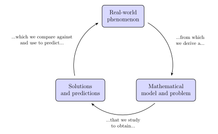



# Mathematical Modelling

::: {.callout-tip}

## Aims of the chapter

By the end of this chapter, you should be able to:

* Explain what a mathematical model is.
* Describe the modelling cycle.
* Classify mathematical problems as forward, inverse, or control problems.

:::

In the previous two chapters we have introduced differential equations and discussed methods for their solution. In some of the examples, however, we have seen that the equations were motivated from a real-world phenomenon and that we used the solutions to better understand such phenomena. In some cases, we even had to formulate the equations ourselves, based on observations and assumptions about the phenomenon (think of the mixing problem, @exm-mixing). This is the essence of *mathematical modelling* (or modelling for short), which we will discuss in this chapter.^[In fact, we often refer to the equations as *models* when they are used to describe a phenomenon. In the previous chapters I deliberately avoided this terminology to avoid confusion.] 

## What is a model?

Let us start with a definition.

::: {.callout-important}

::: {#def-model}

## Mathematical model

A mathematical model is an **abstract representation** of a concrete **system** using **mathematical concepts** and language. It is a representation of the system that captures its essential characteristics and behaviour, allowing for analysis, prediction, and understanding of the system's dynamics.

:::

:::

Note that I have bolded the three key concepts in the definition. It is an abstract representation because it is not the system itself, but an idealised version of it. It is always related to a system that it tries to represent. And we use mathematical concepts as a tool to describe and analyse this system.

Generally, the purpose of mathematical modelling is gaining insight and expanding knowledge by describing behaviours and trends in real-world problems, and by making predictions about these. As we will see, in the modelling process, assumptions are made that involve simplification and reduction to essential features, characteristics, or quantities of interest. Suitable variables and parameters for these are identified and then related in mathematical equations. This process is guided by some principles and systematic procedures, and it hopefully leads to equations that can be solved and further analysed. In fact, the choices made to formulate the model are informed by available tools, methodology, and techniques for its study. Before we discuss the modelling process in more detail, let us look at an example (or rather revisit it).

::: {#exm-mass-spring-damper-revisited}

## Mass-spring-damper: derivation revisited

Let us consider again the mass-spring-damper system we introduced in @sec-mass-spring-damper. We outlined the physical principles that lead to the differential equation, but looks in detail into the various assumptions:

1. The only forces acting on the mass are the spring force and the damping force (i.e. we neglect gravity, friction, and any other forces).
2. The spring can be assumed to be linear with a constant $k$, i.e. the spring force is proportional to the displacement of the mass from its equilibrium position.^[This is known as Hooke's law, named after Robert Hooke, and English polymath from the 17th century. Trivia fact: Hooke coined the term "cell" for the basic unit of biological tissue.] This is usually a good approximation for small displacements, but for larger displacements the spring may behave nonlinearly.
3. The damper can be assumed to be linear as well with a constant $c$, i.e. the damping force is proportional to the velocity of the mass. Again, this is usually a good approximation for small velocities, but for larger velocities the damper may behave nonlinearly. We also assume that the damping does not depend on the position of the mass (i.e. we will not hit the wall of the damper^[Dampers usually contain a piston in a viscous fluid.]).

We denote the position of the mass as $x(t)$ and, for simplicity, we define the origin to be the position where the spring is "relaxed" (i.e. when it exerts no force on the mass). Then, as we saw in @sec-mass-spring-damper, we can use our assumptions to write the forces that both the spring and the damper exert on the mass:

$$
F_k = -k x(t), \quad F_c = -c \frac{\mathrm{d}}{\mathrm{\mathrm{d}}t} x(t).
$$

The negative signs denote that the forces oppose the displacement and velocity, respectively. In order to build the model, we also need to relate the forces to the position of the mass (or, in this case, its acceleration). We use Newton's second law to relate the forces to the acceleration of the mass. This would not be considered an assumption, but rather a principle that is well established and experimentally verified. It states that the sum of the forces acting on an object is equal to the mass of the object multiplied by its acceleration and, given that we assumed the only forces acting on the mass are the spring and damping forces, we have

$$ 
m \frac{\mathrm{d}^2}{\mathrm{d}t^2} x(t) = F_k + F_c = -k x(t) - c \frac{\mathrm{d}}{\mathrm{d}t} x(t).
$$

:::

This example illustrates the modelling process. In this case we were quite lucky that people like Newton and Hooke did most of the heavy lifting for us, and we could use well established principles to formulate the model. However, in many other applications, we have to make more assumptions and simplifications, and we have to be careful that these are reasonable and do not lead to a model that is too far from reality as we will see in @sec-modelling-cycle

## Mathematical problems

Models are just a tool to solve a *mathematical problem*, often also formulated in the form of a *mathematical question*. Whilst a mathematical model lists variables and relations between these, the problem states which variable are assume known and which variable one wishes to identify or find. In short, the mathematical problem tells us what we want to achieve with the model. We then apply mathematical methods, tools, and techniques to that problem in order to solve or analyse it and, from it, make predictions and draw other useful conclusions from the system we want to understand.

::: {.callout-important}
There are three broad types of problems:

1. *Forward problems*, or *evaluation questions*. Given all needed information about a process or phenomenon, an we quantitatively predict its other properties and how it will function?

   Examples: What is the maximum attainable speed of this car? How quickly will this disease spread through the population of this city?

2. *Inverse problems*, or *detection questions*. If some information about a phenomenon is not directly available, can it be “reverse engineered” from observations?

   Examples: How can we use data from CT scans to estimate the location of a tumour? Can we determine the damping of an oscillating pendulum from the decay of its time series height data?

3. *Control problems*, or *design questions*: Can we create a solution that best meets a specified goal?

   Examples: What shape is best for a paper airplane to make it fly furthest? How should a pill be coated to release its drug at a constant rate over an entire day?

:::

::: {#exm-mass-spring-damper-forward-inverse-control}

## from April exam 25-26

Let us now ground these concepts by looking at the mass-spring-damper system again. Consider the following real-world scenarios; are they a forward, inverse, or control problem?

1. **Predict the position of the mass at a given time.** This is a forward problem, as we need to determine the variable $x(t)$ at a given time $t$ from the model (as it is not stated otherwise, we assume that we are given the initial conditions and parameters).
2. **Decide which damper we need to achieve critical (i.e. optimal) damping.** This is an control problem, as we aim to design a system that meets a specific goal, in this case achieving critical damping.
3. **Compute the time it will take for the oscillations to decay below a certain threshold.** This is a forward problem, as we need to determine the variable $x(t)$, similarly to the first scenario. Despite sounding like an inverse problem, as we are given a threshold and need to find the time, we are still solving for $x(t)$ and then determining when it crosses the threshold, so it is a forward problem.
4. **Calculate the spring constant from experimental data.** This is an inverse problem, as we are aiming to determine a parameter of the system (the spring constant) from measurements.
5. **Determine the forcing necessary to keep the system oscillating at a given frequency and amplitude.** This is a control problem, as we are aiming to influence the system to achieve a specific behaviour.
:::

## The modelling cycle {#sec-modelling-cycle}

{#fig-modelling-cycle width="80%"}

Now that we have introduced the concepts of a mathematical model and a mathematical problem, let us consider how one goes about creating them for a real-world phenomenon. To do so, we introduce the concept of a *modelling cycle*, shown in @fig-modelling-cycle, which is a systematic approach to mathematical modelling. It consists of several stages that are iteratively applied to refine the model and ensure its accuracy and relevance.

We start on with a real-world phenomenon or process that we want to study. In order to do so, we formulate a mathematical model that captures the essential characteristics of the phenomenon. This involves identifying suitable variables and parameters, and establishing relationships between them through equations, making a series of assumptions in the process. This model will be the core of the mathematical problem we want to study. Then, we study the mathematical problem using suitable mathematical tools, which will strongly depend on the nature of the model and the problem. The goal is to obtain insight on the problem either by computing analytical solutions or, if it is not possible, using alternative methods, like approximating the solution numerically (e.g. @sec-euler) or studying its qualitative behaviour (e.g. @sec-autonomous-differential). From the solution we can then draw conclusions and make predictions about the real-world phenomenon. Finally, we close the cycle by validating these conclusions and predictions against observations and measurements of the real-world problem. If the outcome is not satisfactory, we may need to refine the model by revisiting the assumptions and relationships made in the formulation stage, and then repeat the cycle until we are happy with the outcome. 

The bulk of this module focuses on the study of the equations that arise from the modelling process, so let us now briefly discuss the other two steps of the modelling cycle, namely model formulation and model validation.

### Model formulation

The first step is to formulate a mathematical model that captures the essential characteristics of the phenomenon we are interested in. In @exm-mass-spring-damper-revisited we saw a real (yet quite simple) example, but often it is a lot more complicated than that. In this section we will consider two other examples, one arising from chemistry and one from electrical engineering, to illustrate the process of model formulation. We will also see a more complicated example about modelling a disease outbreak in the next section, when we discuss the validation of models. But, before that, let us expand on the general principles of model formulation.

The model formulation step involves transforming a real-world phenomenon into a mathematical representation. Inevitably, no matter how complicated our model ends up being, this representation will be a simplified version of the real-world. The process involves identifying the suitable *variables* that quantify the aspects of the phenomenon that we are interested in (and thus deciding which ones are we happy to ignore). 

Once we have defined the variables, we need to establish relationships between them, which is usually done by making a series of assumptions. These assumptions are based on our understanding of the phenomenon and may involve simplifications, idealisations, or approximations. The goal is to capture the essential characteristics of the phenomenon while keeping the model tractable. Sometimes these relationships are guided by well-established principles, such as Newton's laws in @exm-mass-spring-damper-revisited, but in many cases they are based on empirical observations and may be more ad-hoc, for example when in @exm-fishery we assumed that the fishing rate is proportional to the population. The resulting relationships are expressed in mathematical form: they are often in the form of equations (differential or difference for the models in this module) but they could be as simple as an explicit empirical formula, or as complicated as a coupled system of partial differential equations. In any case, the relationships are expressed in mathematical terms.

::: {.callout-note}
The examples below are purely to illustrate the model formulation process. They draw on principles from other areas and which you are not expected to know. In do not expect you to know the details of the examples in the exam, or of the underpinning physics. If an example is used in an exam question, all the necessary information and guidance will be provided.
:::

::: {#exm-law-of-mass-action}
## Law of mass action

We want to model a chemical reaction. Modelling chemical reactions is very complicated, but we start with a very simple model here. Consider a reaction of the form
$$
A + B \overset{k_1}{\underset{k_2}{\rightleftharpoons}} C.
$$ {#eq-chemical-reaction}

This means that a chemical $A$ reacts with a chemical $B$ to produce a chemical $C$. In this case we assume that one mol of $A$ reacts with one mol of $B$ to produce one mol of $C$. The reaction is reversible (i.e. $C$ can break down into $A$ and $B$ again) and the rate at which each reaction occurs^[That is, how fast the reaction takes place.] is determined by the constants $k_1$ (left to right) and $k_2$ (right to left).

We can invoke the *law of mass action* to translate the chemical reaction in @eq-chemical-reaction into a set of differential equations, which are called *rate equations*. It basically states that the evolution of the concentration^[The amount of substance per unit volume.] $r(t)$ for a given reactant $R$ involved in $j_R$ reactions, is given by

$$
\frac{\mathrm{d}}{\mathrm{\mathrm{d}}t} r(t) = \sum_{k=1}^{j_R} X_k - \sum_{k=1}^{j_R} Y_k,
$$

where, $X_k$ and $Y_k$ represent the creation and consumption rates of $R$ by reaction $k$, respectively, and are proportional to the product of the concentrations of the reactants involved in the reaction, with a proportionality constant given by the reaction rate constant. For the reactants $A$, $B$, and $C$ in the above example @eq-chemical-reaction, we would obtain

$$\begin{aligned}
\frac{\mathrm{d}}{\mathrm{\mathrm{d}}t} a(t) = k_2 c(t) - k_1 a(t) b(t), \\
\frac{\mathrm{d}}{\mathrm{\mathrm{d}}t} b(t) = k_2 c(t) - k_1 a(t) b(t), \\
\frac{\mathrm{d}}{\mathrm{\mathrm{d}}t} c(t) = k_1 a(t) b(t) - k_2 c(t),
\end{aligned}$$

where $a(t)$, $b(t)$, and $c(t)$ are the concentrations of $A$, $B$, and $C$ at time $t$, respectively. The first term on the right-hand side of each equation is the creation rate (hence the $+$ sign) and the second term is the consumption rate (hence the $-$ sign). Note that the creation rate of $A$ and $B$ is the same as the consumption rate of $C$, and vice versa, which is a consequence of mass conservation.

If several molecules of a reactant are involved in a reaction then we have to count each in the creation rate and the consumption rate. Let us consider a more complicated example and assume that $n_A$ molecules of $A$ and $n_B$ molecules of $B$ react to $n_C$ molecules of $C$ and $n_D$ molecules of $D$,

$$
n_A A + n_B B \overset{k}{\to} n_C C + n_D D.
$$

The numbers $n_A,n_B,n_C,n_D$ are called *stoichiometries* and they appear both as prefactors in the creation/consumption rates (i.e. how many mols of each species are created/consumed) and in the exponents of the concentrations (i.e. how many mols of each species are needed for the reaction to occur). The corresponding rate equations^[Here we have multiple differential equations coupled together, which is known as a system of differential equations. We will see how to study them in @sec-systems.] read:

$$\begin{aligned}
\frac{\mathrm{d}}{\mathrm{\mathrm{d}}t} a(t) = -n_A k a(t)^{n_A} b(t)^{n_B} , \\
\frac{\mathrm{d}}{\mathrm{\mathrm{d}}t} b(t) = -n_B k a(t)^{n_A} b(t)^{n_B} , \\
\frac{\mathrm{d}}{\mathrm{\mathrm{d}}t} c(t) =  n_C k a(t)^{n_A} b(t)^{n_B} , \\
\frac{\mathrm{d}}{\mathrm{\mathrm{d}}t} d(t) =  n_D k a(t)^{n_A} b(t)^{n_B} .
\end{aligned}$$

Note that this reaction is irreversible, as $C$ and $D$ cannot combine to produce $A$ and $B$ again. The actual *rate* here is the same for all reactants and given by

$$
\frac{1}{n_A} \frac{\mathrm{d}}{\mathrm{\mathrm{d}}t} a(t) = \frac{1}{n_B} \frac{\mathrm{d}}{\mathrm{\mathrm{d}}t} b(t) = -\frac{1}{n_C} \frac{\mathrm{d}}{\mathrm{\mathrm{d}}t} c(t) = -\frac{1}{n_D} \frac{\mathrm{d}}{\mathrm{\mathrm{d}}t} d(t) = k a(t)^{n_A} b(t)^{n_B}.
$$

Note that then

$$
\frac{\mathrm{d}}{\mathrm{\mathrm{d}}t} \Big{(} \frac{1}{n_A} a(t) + \frac{1}{n_C} c(t) \Big{)} = 0,
$$ {#eq-masscons}

and analogously for the combinations $(A,D)$, $(B,C)$ and $(B,D)$. These are identities that express *mass conservation*, namely, that all atoms (or, respectively, their masses) that are present before the reaction are also present after the reaction, just bound in different molecules.^[Mass conservation is another of those well established physical principles, like Newton's laws, that we can use to formulate certain models.]
:::

::: {#exm-samuelson}

## Hansen-Samuelson multiplier-accelerator model

We want to model the evolution of the gross domestic product (GDP) of a country over time. The GDP is the total value of goods and services produced in a country in a given period of time, and it is an important indicator of the economic health of a country. We will write a very (very!) simplified model, known as the Hansen-Samuelson model.^[Written by US economist Paul Samuelson, who credited his fellow economist Alvin Hansen for the idea. Samuelson was awarded the Nobel prize in economics in 1970.] It is based on the following assumptions:

1. We are only interested in the GDP at discrete time intervals, say every year, and we denote the GDP at a given time $t$ by $Y_t$.
2. The GDP is the sum of the consumption $C_t$ (i.e. how much people spend), the investment $I_t$ (i.e. how much businesses invest in new capital), and the government spending $G_t$ (i.e. how much the government spends on public services and infrastructure). Mathematically, $Y_t = C_t + I_t + G_t$.
3. The consumption at a given year is proportional to the GDP of the previous year, $C_t = \alpha Y_{t-1}$, with $0 < \alpha < 1$. This represents the idea that people only spend a fraction of their income.
4. The investment at a given year is proportional to the change in consumption from the previous year, $I_t = \beta (C_t - C_{t-1})$, with $\beta > 0$. This represents the idea that businesses invest more when the economy is growing and therefore there is more demand, and less when it is shrinking.
5. The government spending is assumed to be constant, $G_t = G > 0$. That is, government's actions are not influenced by the state of the economy.^[If you have been following the news in the past few years, you will be well aware that this assumption is not realistic at all.]

Combining all the assumptions above (i.e. plugging 3-5 into 2) we obtain

$$
Y_t = \alpha (1 + \beta) Y_{t-1} - \alpha \beta Y_{t-2} + G.
$$

This is a second order linear difference equation with constant coefficients, much like the ones we studied in @sec-difference-equations. We can study it using the same techniques, and we will see that the GDP will either converge to a steady state, oscillate around it, or grow to infinity, depending on the values of $\alpha$ and $\beta$. 

In contrast with @exm-law-of-mass-action, this model is not based at all on any well established physical principles. Instead it is based on a series of assumptions that are made to capture the essential characteristics of the economy (and thus human nature). Parameters $\alpha$ and $\beta$ are not something that we can go and measure in the lab or get from a book, and they must be estimated from data. Therefore, it is paramount to parameterise and validate the model against reality, which is the focus of the next section.
:::

### Model validation

Once we have formulated a model and studied the associated mathematical problem, we need to validate the model against reality. Crucially, this step will tell us if we can stop or if we need to around the modelling cycle again and refine our model.

When it comes to comparing the model with reality, there are multiple aspects to consider. Typically, we will want to compare the prediction of the model with observations and measurements of the real-world phenomenon. Ideally, we want *quantitative agreement*, that is comparing the values predicted by the model with the values measured in reality, and computing the error between them. However, this is not always possible, and for simple models for complex systems we may have to settle for *qualitative agreement*, that is comparing the general behaviour of the model with the general behaviour of the phenomenon. For example, if we are modelling a disease outbreak, we may not be able to predict the exact number of infected individuals at a given time, but we may be able to predict the general trend of the outbreak (e.g. whether it will grow or decline).

In order to make the comparison, we need to have the parameter values for the specific system we want to study. For example, in @sec-mass-spring-damper we found the equation governing the mass-spring-damper system but, for a specific configuration, unless I know the mass, spring constant, and damping coefficient, I will not be able to make quantitative predictions of the system. In this case, we could go to the lab and measure each quantity independently and plug them into our model. However, in more complex cases (e.g. @exm-samuelson for the GDP model) we will not be able to measure the parameters directly, and we will have to estimate them from data. This is known as *parameter estimation* or *model calibration*, and it is basically an inverse sub-problem that we need to solve first in order to eventually solve our problem.

After the validation step, we can decide if we are happy with the insight and predictions we have obtained from the model, or if we missed any critical bits. In that case, we need to go back and refine our model: we need to revise the assumptions we made in the formulation step, and possibly add more variables and relationships to capture the essential characteristics of the phenomenon. We then repeat complete the cycle and reassess.

Finally, once we are happy with the model, we can use it to make predictions and draw conclusions about the real-world phenomenon. It is important to always keep in mind the real-world system and not trust blindly the outcome of the model. Often we will be able to validate the model against a certain scenario, but we will want to predict other scenarios. In that case, we need to be aware of the model limitations and that we are not extrapolating beyond the range of validity of the model. Because in this case we do not have data to validate the model against, we need to be extra careful and critical about the results obtained.^[There is also always the risk of making mistakes in the calculations, so that is another good reason to stop and think whether the results make any sense. A classical example of this is when you end up with a negative population or concentration, which is clearly not physically possible.]

::: {#exm-covid}

## Covid-19

Luckily for us, the Covid-19 pandemic is now over, but it was a very relevant case on which we used modelling to tackle a very real (and serious) problem. We also have a lot of data available, which makes it a good example to illustrate the modelling cycle.

We will focus on the first wave of the pandemic in England, which took place in March 2020. The data we have is the number of confirmed Covid-19 infections per day, which was collected by the UK Health Security Agency and is available through their [dashboard](https://ukhsa-dashboard.data.gov.uk/). In @fig-covid-motivation we show the data for the first 120 days of the pandemic, starting on 01/03/2020 (day 0 in the graph).

```{python}
#| label: fig-covid-motivation
#| fig-cap: "Confirmed COVID-19 cases between 01/03/2020 and 28/06/2020 in England."
#| out-width: "80%"
#| echo: false

import numpy as np
import matplotlib.pyplot as plt
from utils import apply_style, plot_covid_data

apply_style()

fig, ax = plt.subplots(figsize=(6, 3.5))

df = plot_covid_data(
    ax,
    csv_path     = "figs\\ukhsa-covid-data.csv",
    start_date   = "2020-03-01",
    end_date     = "2020-06-28",
    relative_days= True,           # False for absolute dates
    ylabel       = "Cases",
    color        = "C0",
)

plt.tight_layout()
plt.show()
```

Suppose now we are 30 days into the outbreak and would like to make a prediction about the number of infected people, as shown in @fig-covid-short-period. The simplest approach we could take would be to simply fit some curves to the data and use their extensions for a prediction. This means we only use data processing tools and completely ignore any knowledge we may have about disease spreading and any context of the data.

```{python}
#| label: fig-covid-short-period
#| fig-cap: "Confirmed COVID-19 cases between 01/03/2020 and 30/03/2020 in England."
#| out-width: "80%"
#| echo: false

import numpy as np
import matplotlib.pyplot as plt
from utils import apply_style, plot_covid_data

apply_style()

fig, ax = plt.subplots(figsize=(6, 3.5))

df = plot_covid_data(
    ax,
    csv_path     = "figs\\ukhsa-covid-data.csv",
    start_date   = "2020-03-01",
    end_date     = "2020-03-30",
    relative_days= True,           # False for absolute dates
    ylabel       = "Cases",
    color        = "C0",
)

plt.tight_layout()
plt.show()
```

We observe that the numbers effectively increase, but there are many increasing functions that could describe the trend. Writing $t$ for the time measured in days, for instance, a quadratic polynomial of the form $p(t) = m t^2$ with a suitable number $m>0$ or an exponential function of the form $f(t) = s e^{ct}$ with parameters $s,c>0$ could effectively capture the growth. For some suitable parameters $m$, $s$, and $c$ we indeed seem to be able to get good fits in that the curves nicely run through the data points for the first 30 days, as shown in @fig-covid-short-period-fit.

```{python}
#| label: fig-covid-short-period-fit
#| fig-cap: "Fitted models for the first 30 days. Orange is the quadratic and green is the exponential."
#| out-width: "80%"
#| echo: false

import numpy as np
import matplotlib.pyplot as plt
from utils import apply_style, plot_covid_data

apply_style()

fig, ax = plt.subplots(figsize=(6, 3.5))

df = plot_covid_data(
    ax,
    csv_path     = "figs\\ukhsa-covid-data.csv",
    start_date   = "2020-03-01",
    end_date     = "2020-03-30",
    relative_days= True,           # False for absolute dates
    ylabel       = "Cases",
    color        = "C0",
)

# ── Fitted models ───────────────────────────────────────────
from scipy.optimize import curve_fit

# ── Define your models ─────────────────────────────────────────────────────────
def quadratic(t, m):
    return m * t**2

def exponential(t, s, c):
    return s * np.exp(c * t)

# ── Fit to data and plot ──────────────────────────────────────────────────────
days = (df["date"] - df["date"].iloc[0]).dt.days.values

guesses = [[1], [1, 1]]
colours = ["C1", "C2"]

for model, guess, colour in zip([quadratic, exponential], guesses, colours):
   popt, pcov = curve_fit(
      model, days, df["metric_value"],
      p0=guess,
      maxfev=10000,
   )

   # ── Overlay on the plot ────────────────────────────────────────────────────
   t_fine = np.linspace(days[0], days[-1], 400)
   ax.plot(t_fine, model(t_fine, *popt), color=colour, label="Model")

plt.tight_layout()
plt.show()
```

Let us now use these curves for a prediction: in @fig-covid-short-period-fit-validation we plot the data and the curves for the whole 120 days. It does not look very good. Non of the approaches is able to describe the fact that the infection numbers reach a maximum before decaying again. Of course, for the fits we had chosen functions that increase, however this was inspired by the trend in the data for the first 30 days. In order to recover the observed behaviour of the infections numbers for the later days we need to combine the data with some additional knowledge about what they mean and describe.


```{python}
#| label: fig-covid-short-period-fit-validation
#| fig-cap: "Fitted models for the first 30 days validated against data for the first 120 days. Orange is the quadratic and green is the exponential."
#| out-width: "80%"
#| echo: false

import numpy as np
import matplotlib.pyplot as plt
from utils import apply_style, plot_covid_data

apply_style()

fig, ax = plt.subplots(figsize=(6, 3.5))

df = plot_covid_data(
    ax,
    csv_path     = "figs\\ukhsa-covid-data.csv",
    start_date   = "2020-03-01",
    end_date     = "2020-06-28",
    relative_days= True,           # False for absolute dates
    ylabel       = "Cases",
    color        = "C0",
)

# ── Fitted models ───────────────────────────────────────────
from scipy.optimize import curve_fit

# ── Define your models ─────────────────────────────────────────────────────────
def quadratic(t, m):
    return m * t**2

def exponential(t, s, c):
    return s * np.exp(c * t)

# ── Fit to data and plot ──────────────────────────────────────────────────────
days = (df["date"].iloc[0:30] - df["date"].iloc[0]).dt.days.values
total_days = (df["date"] - df["date"].iloc[0]).dt.days.values

guesses = [[1], [1, 1]]
colours = ["C1", "C2"]

for model, guess, colour in zip([quadratic, exponential], guesses, colours):
   popt, pcov = curve_fit(
      model, days, df["metric_value"].iloc[0:30],
      p0=guess,
      maxfev=10000,
   )

   # ── Overlay on the plot ────────────────────────────────────────────────────
   t_fine = np.linspace(total_days[0], total_days[-1], 400)
   ax.plot(t_fine, model(t_fine, *popt), color=colour)

plt.tight_layout()
plt.show()
```

Mathematical models of infectious disease epidemiology track the infected individuals in a population using assumptions about transmission and recovery of the disease. A classical approach is the *SEIR model*, on which many later, refined models are based. The population, denoted by $N$, is assumed constant in time and split into *susceptible* individuals $S(t)$, *exposed* (but not yet infectious) individuals $E(t)$, *infected* (and infectious) individuals $I(t)$, and *recovered*^[At least in the best case. Somewhat cynically, the notation $R(t)$ also allows for the interpretation as a *removed* individual...] individuals $R(t)$. As indicated, these population compartments depend on time $t$ measured here in days, but they have to sum up to the overall population at any time,

$$
S(t) + E(t) + I(t) + R(t) = N \quad \forall t.
$$

Assumptions are then made about the changes of the compartments:

1. Susceptible individuals get in contact with other people, and the chance that another person is infectious is $I(t) / N$. We assume that they become exposed from such a contact at a rate that is proportional to a factor $\beta > 0$.
2. Exposed individuals become (ill and) infectious at a rate with a factor denoted by $\epsilon > 0$.
3. Individuals from the compartment $I(t)$ recover at a rate with a factor denoted by $\gamma > 0$.

Denoting the change with a time derivative we obtain a set of differential equations, one equation for each compartment:

$$\begin{aligned}
\frac{dS}{\mathrm{\mathrm{d}}t}(t) &= - \beta \frac{I(t)}{N} S(t), \\
\frac{dE}{\mathrm{\mathrm{d}}t}(t) &= \beta \frac{I(t)}{N} S(t) - \epsilon E(t), \\
\frac{dI}{\mathrm{\mathrm{d}}t}(t) &= \epsilon E(t) - \gamma I(t), \\
\frac{dR}{\mathrm{\mathrm{d}}t}(t) &= \gamma I(t).
\end{aligned}$$

@fig-seir-example shows a typical solution to the system of differential equations, where we start with a high number $S(0)$, a small number $I(0)$, and $E(0) = R(0) = 0$.


```{python}
#| label: fig-seir-example
#| fig-cap: "Example of the type of solutions the SEIR model produces. The number of infected individuals $I(t)$ increases to a maximum before decaying again."
#| out-width: "80%"
#| echo: false

import numpy as np
import matplotlib.pyplot as plt
from scipy.integrate import solve_ivp
from utils import apply_style, set_zero_axes

apply_style()

# ── Parameters ────────────────────────────────────────────────────────────────
N     = 10_000
beta  = 0.5    # transmission rate  (R0 = beta/gamma = 4)
sigma = 0.2    # 1 / incubation period (≈ 5 days)
gamma = 0.1    # 1 / infectious period (≈ 10 days)

E0 = 0
I0 = 5
S0 = N - E0 - I0
R0_init = 0

# ── Solve SEIR ────────────────────────────────────────────────────────────────
def seir(t, y):
    S, E, I, R = y
    dS = -beta * S * I / N
    dE =  beta * S * I / N - sigma * E
    dI =  sigma * E - gamma * I
    dR =  gamma * I
    return [dS, dE, dI, dR]

sol = solve_ivp(
    seir,
    t_span=(0, 200),
    y0=[S0, E0, I0, R0_init],
    t_eval=np.linspace(0, 200, 1000),
    method="RK45",
)

t = sol.t
S, E, I, R = sol.y

# ── Plot ──────────────────────────────────────────────────────────────────────
fig, ax = plt.subplots(figsize=(6, 3.5))

ax.plot(t, S, color="steelblue", label="$S$ (Susceptible)")
ax.plot(t, E, color="orange",    label="$E$ (Exposed)")
ax.plot(t, I, color="tomato",    label="$I$ (Infectious)")
ax.plot(t, R, color="seagreen",  label="$R$ (Recovered)")

ax.set_xlim(0, t[-1])
ax.set_ylim(0, N * 1.05)
set_zero_axes(ax, xlabel="Time", ylabel="People")
ax.set_xticks([])
ax.set_yticks([])
ax.legend(loc="center right", frameon=False)

plt.tight_layout()
plt.show()
```

The curve for $I$ looks very promising, this is effectively the behaviour that our numbers display and that we expect!

Getting back to our prediction problem, we choose parameters $\beta, \gamma, \epsilon$ and initial values such that fairly good fit of the $I(t)$ values with the infections in the first 30 days is obtained.^[In practice this is a very hard problem and one cannot just go and fit all parameters, one needs to use some prior knowledge about the disease to reduce the number of free parameters.] The result is shown in @fig-covid-short-period-seir, where we can see that the SEIR model is able to capture the trend of the data for the first 30 days.

```{python}
#| label: fig-covid-short-period-seir
#| fig-cap: "SEIR model for the first 30 days, where we have fitted the model to data to determine the parameters."
#| out-width: "80%"
#| echo: false

import numpy as np
import matplotlib.pyplot as plt
from utils import apply_style, plot_covid_data

apply_style()

fig, ax = plt.subplots(figsize=(6, 3.5))

df = plot_covid_data(
    ax,
    csv_path     = "figs\\ukhsa-covid-data.csv",
    start_date   = "2020-03-01",
    end_date     = "2020-03-30",
    relative_days= True,           # False for absolute dates
    ylabel       = "Cases",
    color        = "C0",
)

# ── Fitted models ───────────────────────────────────────────
from scipy.integrate import solve_ivp
from scipy.optimize import curve_fit

# ── SEIR model ─────────────────────────────────────────────────────────────────
def seir(t, S, E, I, R, beta, sigma, gamma):
    dS = -beta * S * I
    dE =  beta * S * I - sigma * E
    dI =  sigma * E - gamma * I
    dR =  gamma * I
    return [dS, dE, dI, dR]

# ── Wrapper for curve_fit: takes t and free parameters, returns I(t) ──────────
def seir_I(t, beta, sigma, gamma, E0, I0, N):
    S0 = 1 - E0 - I0
    R0 = 0
    sol = solve_ivp(
        lambda t, y: seir(t, y[0], y[1], y[2], y[3], beta, sigma, gamma),
        t_span=(t[0], t[-1]),
        y0=[S0, E0, I0, R0],
        t_eval=t,
        method="RK45",
        dense_output=False,
    )
    return N * sol.y[2]   # return I(t)

# ── Fit to data ───────────────────────────────────────────────────────────────
days_to_fit = 30
days = (df["date"].iloc[0:days_to_fit] - df["date"].iloc[0]).dt.days.values.astype(float)
data = df["metric_value"].iloc[0:days_to_fit].values
total_days = (df["date"] - df["date"].iloc[0]).dt.days.values.astype(float)

# The very tight bounds represent the fact that we have a good idea of what the parameters
# should be, which is part of the modelling process
p0     = [1, 0.05, 0.05, 1e-3, 1e-3, 1e4]
bounds = ([0.5, 0.04, 0.04, 1e-6, 1e-6, 1], [1.5, 0.06, 0.06, 1, 1, 2e4])

popt, pcov = curve_fit(
    seir_I, days, data,
    p0=p0, bounds=bounds,
    maxfev=10000,
)

# ── Overlay fitted I(t) on the plot ──────────────────────────────────────────
t_fine = np.linspace(total_days[0], total_days[-1], 400)
ax.plot(t_fine, seir_I(t_fine, *popt), color="tomato", label="SEIR fit")

plt.tight_layout()
plt.show()
```

Let us now use these parameters or, respectively, the solution to the corresponding system of differential equations to make a prediction. Below we plot the infection data and the numerically obtained $I(t)$ values for the first 120 days.

```{python}
#| label: fig-covid-very-long-period
#| fig-cap: "SEIR model for the first 30 days, where we have fitted the model to data to determine the parameters."
#| out-width: "80%"
#| echo: false

import numpy as np
import matplotlib.pyplot as plt
from utils import apply_style, plot_covid_data

apply_style()

fig, ax = plt.subplots(figsize=(6, 3.5))

df = plot_covid_data(
    ax,
    csv_path     = "figs\\ukhsa-covid-data.csv",
    start_date   = "2020-03-01",
    end_date     = "2020-06-28",
    relative_days= True,           # False for absolute dates
    ylabel       = "Cases",
    color        = "C0",
)

# ── Fitted models ───────────────────────────────────────────
from scipy.integrate import solve_ivp
from scipy.optimize import curve_fit

# ── SEIR model ─────────────────────────────────────────────────────────────────
def seir(t, S, E, I, R, beta, sigma, gamma):
    dS = -beta * S * I
    dE =  beta * S * I - sigma * E
    dI =  sigma * E - gamma * I
    dR =  gamma * I
    return [dS, dE, dI, dR]

# ── Wrapper for curve_fit: takes t and free parameters, returns I(t) ──────────
def seir_I(t, beta, sigma, gamma, E0, I0, N):
    S0 = 1 - E0 - I0
    R0 = 0
    sol = solve_ivp(
        lambda t, y: seir(t, y[0], y[1], y[2], y[3], beta, sigma, gamma),
        t_span=(t[0], t[-1]),
        y0=[S0, E0, I0, R0],
        t_eval=t,
        method="RK45",
        dense_output=False,
    )
    return N * sol.y[2]   # return I(t)

# ── Fit to data ───────────────────────────────────────────────────────────────
days_to_fit = 30
days = (df["date"].iloc[0:days_to_fit] - df["date"].iloc[0]).dt.days.values.astype(float)
data = df["metric_value"].iloc[0:days_to_fit].values
total_days = (df["date"] - df["date"].iloc[0]).dt.days.values.astype(float)

# The very tight bounds represent the fact that we have a good idea of what the parameters
# should be, which is part of the modelling process
p0     = [1, 0.05, 0.05, 1e-3, 1e-3, 1e4]
bounds = ([0.5, 0.04, 0.04, 1e-6, 1e-6, 1], [1.5, 0.06, 0.06, 1, 1, 2e4])

popt, pcov = curve_fit(
    seir_I, days, data,
    p0=p0, bounds=bounds,
    maxfev=10000,
)

# ── Overlay fitted I(t) on the plot ──────────────────────────────────────────
t_fine = np.linspace(total_days[0], total_days[-1], 400)
ax.plot(t_fine, seir_I(t_fine, *popt), color="tomato", label="SEIR fit")

plt.tight_layout()
plt.show()
```

This looks quite good, the solution captures the trend in the data points with the increase and the decay, even the maximum looks at a good position. So the mess of data is effectively fairly well described by a couple of equations with very few parameters. Now, can we further extend the prediction? Let us look into a year, as shown in @fig-covid-very-long-period. Whilst the model can describe the first wave, the computed values for $I(t)$ stay close to zero after and the model fails to pick up the later waves, particularly the one early in 2021 caused by a new variant of the virus. For this purpose, more sophisticated models would be needed.


In this example we have seen the modelling cycle in action. In fact, we have done multiple cycles: we first tried to fit simple curves to the data, which did not work. We then formulated a model based on assumptions about the disease spreading and fitted it to the data, which worked well for the first wave. However, we also saw that this model is not able to predict later waves, and we would need to refine it further in order to capture them.

:::


## Word of caution: all models are wrong!

Before concluding this section, a word of caution. We have seen that it is critical to validate the model against reality, and that it is important to be aware of the model limitations. This is because, in general, models are not perfect representations of reality. They are simplifications and abstractions that capture certain aspects of the phenomenon we are studying, but they may not capture all the complexities and nuances of the real world. Therefore, it is important to be critical and cautious when interpreting the results of a model, and to always keep in mind that:

::: {.callout-important}
$$
\textbf{Mathematical models always have a limited range of validity!}
$$
:::

Many scientists have expressed views about the limitations of models. Some notable examples are:

- Mark Kac explained *Models are, for the most part, caricatures of reality, but if they are good, they portray some features of the real world.*^[M. Kac: *Some mathematical models in science*. Science 166, 695--699 (1969).]

- In one of his papers on developmental biology^[A.M. Turing: *The chemical basis of morphogenesis*. Phil.  Trans. R. Soc. Lond., Series B -- Biol. Sci. 237(641), 37--72 (1952).] Alan Turing wrote *This model will be a simplification and an idealisation, and consequently a falsification. It is to be hoped that the features retained for discussion are those of greatest importance ...*

- Or, the most famous quote about modelling: *...all models are wrong, but some are useful.*^[G.E.P. Box, N.R. Draper: *Empirical Model-Building and Response Surfaces*. Wiley, New York (1987).]
